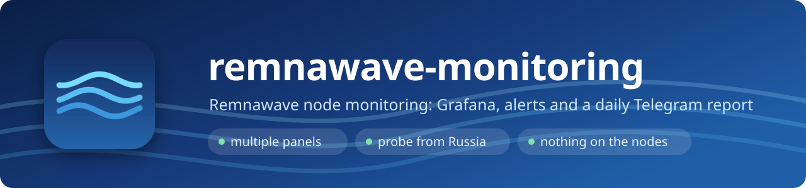
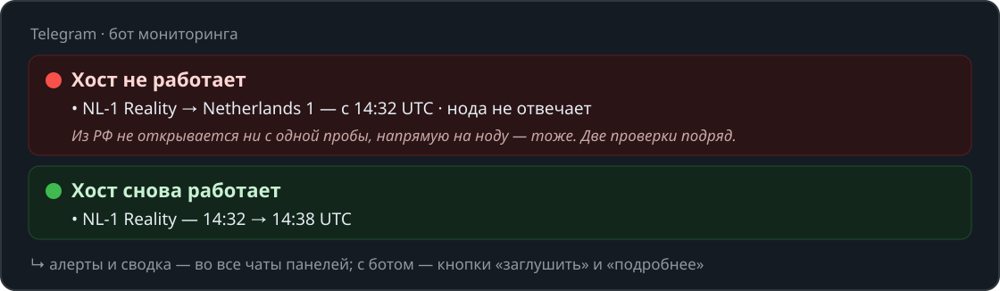
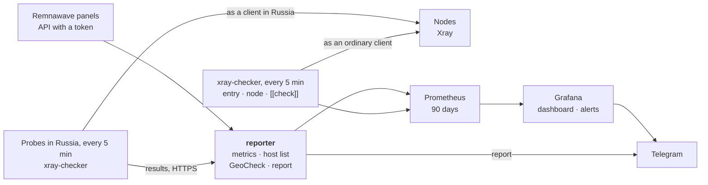

<p align="center">
  
</p>

<p align="center">
  <a href="https://github.com/3APA3A-3AHO3A/remnawave-monitoring/releases/latest"></a>
  <a href="https://github.com/3APA3A-3AHO3A/remnawave-monitoring/actions/workflows/tests.yml"></a>
  <a href="https://github.com/remnawave"></a>
  <a href="https://grafana.com"></a>
  <a href="https://prometheus.io"></a>
  
  <a href="LICENSE"></a>
</p>

<p align="center">
  <a href="#installation">🚀 Install</a> &nbsp;·&nbsp; <a href="#telegram-alerts">🔔 Alerts</a> &nbsp;·&nbsp; <a href="#grafana-dashboard">📊 Dashboard</a> &nbsp;·&nbsp; <a href="#check-from-russia">🇷🇺 Check from Russia</a> &nbsp;·&nbsp; <a href="#configuration">⚙️ Configuration</a> &nbsp;·&nbsp; <a href="README.md">🇷🇺 Русский</a>
</p>

Monitoring for [Remnawave](https://docs.rw) nodes: Grafana dashboards, alerts and a daily report in Telegram. One installation watches one or several panels. It runs next to any of the panels with `docker compose`.

> [!NOTE]
> The Telegram messages, the daily report and the Grafana dashboard are in **Russian**. This page is a translation of the [Russian README](README.md).

> [!TIP]
> **Quick start.** A server with Docker → `git clone` → fill in `.env` and `config.toml` → `./apply.sh` → `rwmon check`. Step by step — [Installation](#installation). The first check results show up in 5–10 minutes.

> [!IMPORTANT]
> **Nothing is installed on the nodes.** Panel data comes from the API with a read-only token, and the checks connect to hosts like an ordinary client. All monitoring services listen on `127.0.0.1` only.

## What it looks like

<p align="center">
  
</p>

## Features

- **Telegram alerts** — a host is down (with the reason: blocked in Russia, broken entry, node not responding), a route check (WARP, Psiphon, a cascade — whatever you describe in `[[check]]`) is down or exits in the wrong place, clients vanished from a node, a panel is unreachable or slow, a website is down, a certificate is about to expire, a node is overloaded. When things recover, a recovery message follows. Details — [Alerts](#telegram-alerts).
- **Grafana dashboard** — key numbers, what is broken right now, a host table (verdict and every check in one row), a node table, a card per node, outbounds, Russian blocklists, panel health, GeoCheck. "Panel" and "Node" selectors.
- **Daily report** — what changed in GeoCheck, failures of the day without duplicates, users and traffic per panel. Plus an HTML GeoCheck table.
- **Route checks from the config** — `[[check]]` blocks: what to open through a host and where the exit must be (not the node IP, the node IP, a country, a network). Hosts are picked by the node's config profile. Details — [Route checks](#route-checks).
- **Multiple panels** — each with its own chat and topic. Identical hosts in different panels are checked once.
- **Check from Russia** — probes on servers in Russia connect to every host like a client app does: you see whether the host works for clients in Russia. The monitoring server checks the same host through its entry and directly on the node — so it is clear where it broke. Details — [Check from Russia](#check-from-russia).
- **Node servers** — optional: disk, swap, the connection table and real CPU usage from [node_exporter](https://github.com/prometheus/node_exporter) on the nodes. Details — [Node servers](#node-servers).
- **Russian blocklists** — every few hours all node IPs and the service's domains are checked against Russian blocklists via [cheburcheck.ru](https://cheburcheck.ru): the RKN registry, blocked subnets and CDNs. With an API token, also with cheburcheck scanners inside Russian operators' networks: you see which ISPs block an address with TSPU, by SNI or by DNS spoofing. Details — [Russian blocklists](#russian-blocklists).
- **Websites and an external watchdog** — checks for your sales site and subscription page, certificate expiry, and a Healthchecks.io ping in case the monitoring server itself goes down.

## How it works



Everything starts with a single `docker compose` and listens on `127.0.0.1` only: the `config` container builds the Prometheus, Grafana and checker configs from `config.toml`, Grafana is exposed through nginx. The only port open to the outside is the one for probes from Russia (9116, HTTPS with the probe's password) — if there are probes. Probes are installed separately, from the `probe/` folder.

- `reporter` gets all panel data through the API with a token, so a second panel needs neither its own domain nor access to its `/metrics`.
- Host checks are done by [xray-checker](https://github.com/kutovoys/xray-checker). The image is built locally from v1.3.1 with four small patches (see [`checker/Dockerfile`](checker/Dockerfile)):
  - Hysteria2 with Salamander `packetSize` support;
  - retries: a single random failure (e.g. a dropped WARP connection) is not counted as an outage;
  - the exit IP and the failure reason in metrics (`xray_proxy_exit_ip`, `xray_proxy_error_code`): the IP shows that a request went out directly, bypassing WARP or Psiphon, and the reason (timeout, closed connection, refused, TLS, DNS) goes into the alert message;
  - an adapter to the new libxray API — to build with current xray-core and libraries free of known vulnerabilities.

  The first build takes a few minutes.
- GeoCheck is run by the panel itself on every node, just like the GeoCheck button in a node card.
- `reporter` is written in Python with no external dependencies.

**Traffic.**

- A check is just a connection setup and a tiny response: about 30 MB per host per month at one check every 5 minutes. A host is checked from every probe in Russia, from the monitoring server on the node (hosts behind a relay or CDN — also through the entry) and by route checks: a regular host with two probes and WARP + Psiphon comes to about 150 MB per month.
- GeoCheck once a day takes a few MB per node; that traffic is spent by the node itself.

## Documentation

<details>
<summary><b>🔔 Telegram alerts</b></summary>

### Telegram alerts

A message is short: what happened, where and why — one line per host or node with the start time and the reason. Once everything is fixed a recovery message arrives. The explanation of an alert is in Grafana, in the rule card.

```
🔴 Хост не работает
• 🇷🇺 LTE 3 · FixErrorVPN → CDN 1 — с 16:34 UTC · не работает вход (прокладка, CDN), нода отвечает
```

The reason in the line: for a host — the verdict (blocked in Russia, broken entry, node not responding, see [Check from Russia](#check-from-russia)); for route checks — timeout, closed connection, refused, TLS or DNS error; for "bypasses ‹check›" — which node's IP the request went out from; for "exits in the wrong place" — the exit country and network; for a website — the response code or "no response"; for a certificate — days left; for "clients vanished" — how many there are now; for "node overloaded" — the CPU or memory percentage. The reason is not part of the alert labels, so a change of reason does not cause extra "recovered" and "down" messages. While something is still down, a reminder comes every `repeat_minutes` (60 min); for certificates — once a day.

| Alert | How it is detected | Sent to |
|---|---|---|
| Host is down | the host's verdict is not "works" for two checks in a row: it does not open from any probe in Russia (hosts of Moscow nodes — from the monitoring server), and the reason comes from the monitoring server's checks through the entry and on the node. After the arrow the message names the node the host leads to: "LTE 3 · OVRO → CDN 1" | all chats |
| "‹check› is down" (WARP, Psiphon…) | the address of a route check from `[[check]]` does not open through the host | all chats |
| Traffic bypasses ‹check› | `egress = "other"`: the address opened, but the reply came from the IP of one of the panels' nodes — the request went out directly. Usually the exit is down and the balancer switched to direct. A node that goes online from a different IP than the one in the panel (NAT) is not covered | all chats |
| ‹Check›: exit not from the node IP | `egress = "node"`: the reply came from a different IP than the node's — the traffic went to another exit | all chats |
| ‹Check›: exit in the wrong place | `egress_country` / `egress_asn`: the exit country or network is not the expected one (DB-IP Lite database) | all chats |
| Clients vanished from a node | the node is connected to the panel, an hour ago it had users, now almost nobody. Looks like IP blocking | all chats |
| Outbound not responding | clients send requests to an outbound (e.g. `psiphon-out`) but almost no responses come back. **Disabled** (paused in Grafana): the outbounds sit behind balancers with a fallback, and uploading a file looks the same as a failure. A real chain failure is caught by the route checks | — |
| Panel API unreachable | the panel does not respond, wrong address or token | all chats |
| Panel is slow | a panel process (api, scheduler or processor) responds slower than `panel_lag_ms` (200 ms) for 5 minutes | all chats |
| Panel process restarted | the process uptime was reset. With the bot: if the panel version changed in the last 40 minutes it was an update, and a quiet line "panel updated to …" arrives; same version means a crash, and the alert comes with sound | all chats |
| Panel uses too much memory | a panel process uses more than `panel_memory_mb` (1024 MB) for 15 minutes | all chats |
| Russian blocklist: scanners see a block | `[rkn] token`: cheburcheck scanners inside Russian operators' networks see the address blocked (at least two of them). The message gives the kind: TSPU, by SNI, DNS spoofing, CDN; which ISPs — in the report and on the dashboard | all chats |
| Russian blocklist: address listed | `[rkn]`: a node IP or a service domain is in the RKN registry, a blocked subnet or a CDN (per cheburcheck.ru). The message says what was found | all chats |
| Probe from Russia is silent | a probe has not sent results for 10 minutes: the host verdict is computed without it (without all probes — from the monitoring server only) | all chats |
| Website down / from Russia | a page from `[[site]]` does not respond from the monitoring server or from the probes in Russia | all chats |
| Certificate expires soon | the site has less than 14 days left | all chats |
| Node overloaded | load above 0.9 per core or more than 90% memory used for 15 minutes | all chats |
| Geo databases not updating | `[node_exporter]`: geoip.dat or geosite.dat on a node is older than 2 days (the age is written by the `rwmon-geodata` cron from [fixerror-node](https://github.com/3APA3A-3AHO3A/fixerror-node)). The core stopped updating them: the geodata block is gone from the profile or the node can't reach GitHub | all chats |
| Hosts are not checked | the host exists in the panel but the checker does not see it (e.g. xray-checker failed to load the list) | all chats |
| reporter / host checks not working | the monitoring itself is broken | all chats |

A node disconnecting from the panel is not tracked here: Remnawave sends a webhook for that itself.

#### Bot with buttons (`[bot]`)

With a `[bot]` block, alerts are sent by a dedicated monitoring bot and every message gets buttons:

- **🔕 1 h / 6 h / 24 h** and **Mute forever** — silence the hosts in this message. The message is updated in every chat: "Muted until 05:20 — Alex" plus a "Restore notifications" button. Muting is shared across chats: when one admin mutes, everyone sees it. Failures of other hosts under the same rule still arrive;
- **Details** — in the same message: the rule, when it started, how long it lasts, the reason, the address, how long the check failed over the last 24 h, what to do. "Back" restores the alert;
- **Open in Grafana** — if Grafana is reachable by domain (`GRAFANA_DOMAIN`).

Commands (only for `admins`):

| Command | Shows |
|---|---|
| `/status` | nodes per panel, hosts per check, websites, blocklists, how many alerts are firing; "What is firing" lists them, muted ones marked |
| `/mutes` | what is muted, until when and by whom; restore one by one or all |
| `/work` | maintenance mode for an hour: alerts arrive without sound and marked "maintenance", and the daily report marks that time so restarts don't read as failures; buttons "+1 hour" and "End maintenance" |
| `/settings` | turn alert groups on or off (nodes and hosts, probes from Russia, blocklists, panels, websites and certificates, the monitoring itself) and the daily report; how often to remind while it is still broken (30 min – 6 h); quiet hours — messages arrive without sound |

Messages are Telegram rich messages (tables, collapsible blocks, time in the reader's time zone). If the client or Telegram rejects them, the same goes out as a regular message with buttons. Mutes and settings are stored by reporter (`bot.json` in its volume) and survive restarts; Grafana still sees every alert as is.

The bot needs its own token: it receives buttons via `getUpdates`, and two listeners on one bot steal each other's clicks. The panel's bot or IP Limiter's bot won't do; a bot that only sends (for example, a backup bot) will. `rwmon check` reports if the bot has a webhook set.

</details>

<details>
<summary><b>📊 Grafana dashboard</b></summary>

### Grafana dashboard

"Panel", "Node" and "Outbound" selectors at the top:

- numbers: users online and subscriptions, nodes connected, hosts working / not working, probes from Russia connected, server network now, client traffic both ways;
- "Broken right now" — the host, what exactly (blocked in Russia, broken entry, node not responding, WARP down…) and for how long; next to it the probes from Russia (connected, hosts checked, how many did not open) and the panels (API, version, uptime, latency);
- websites (from the monitoring server and from Russia, code, response time, certificate) and Russian blocklists;
- "Hosts" — one row per host: verdict, result from every probe in Russia, from the monitoring server through the entry and on the node, route checks, response time from Russia, where the host leads; below it — the verdict history over time;
- "Nodes" — one row per node: link, online and peak, CPU, RAM, disk and conntrack (with `[node_exporter]`), RX/TX, traffic, limit, server and Xray uptime, Xray version;
- three shared charts: clients, network of all nodes (receive up, send down), outbounds;
- "Each node separately" — a card per node: server receive and send;
- collapsed blocks:
  - "Outbounds per node" — the same cards, but only traffic through the outbounds from the "Outbound" filter (WARP, Psiphon): you can see on which node an outbound stopped responding;
  - "Node comparison" — all selected nodes on one chart (clients, traffic, CPU, memory, outbounds);
  - "Node servers" — when `[node_exporter]` is enabled: a table and charts of CPU, memory, swap, disk and the connection table;
  - "Checks in detail" — history and response time from Russia and from the monitoring server per host;
  - "Panel health" — memory, latency and uptime of the panel's own processes;
  - "GeoCheck" — IP, network and risk, which country each service sees, access to Netflix/ChatGPT and so on, GeoIP databases.

The dashboard is generated by [`grafana/dashboard.py`](grafana/dashboard.py): `./apply.sh` builds it for the checks in `config.toml`.

</details>

<details>
<summary><b>📰 Daily report</b></summary>

### Daily report

At the configured time the daily report goes to all chats:

- what changed in GeoCheck (e.g. "Google used to see the node as FI, now RU"). "Needs attention" lists only what is new since yesterday, everything unchanged is a single line; Russian nodes and services from `routed_services` are not highlighted;
- failures of the day: one server in two panels — one line, failures shorter than `short_minutes` (2 min) — one line "and N more short ones"; for a host — the verdict: did not open from Russia, broken entry, node did not respond; a probe from Russia silent for more than 5 minutes — a separate line;
- per panel: users, new and expired during the day, peak clients and traffic per node.

With the bot (`[bot]`) the report opens with a verdict: "✅ All good" or "⚠️ Needs attention" with a list — websites down, an address listed or blocked by scanners, a node overloaded for more than 15 minutes in a day, geo databases not updating, a reboot needed after updates, a certificate with less than 30 days, new GeoCheck problems. Maintenance windows get their own line. Then, briefly: a table of panels (online, last 24 h, traffic to clients ↓ and from clients ↑), failures in one line with the longest one, websites and the nearest certificate, GeoCheck and blocklists. Details are in collapsible blocks: nodes of each panel (clients now / peak, ↓, ↑, outbounds), failures as a list, GeoCheck and blocklists. A blocklist hit muted in the bot is not counted. The report can be turned off in `/settings`.

One HTML report for the day is attached: cards with the key numbers, a timeline of failures, nodes of each panel with client traffic in both directions, outbounds and server network (received / sent), GeoCheck (country per service, changes, unavailable services, the full table and per-node breakdown — collapsed), websites with certificates and blocklists. The report follows the light or dark theme.

</details>

<details>
<summary><b>✅ Requirements and panel preparation</b></summary>

### Requirements

- Remnawave 3.3 or newer: GeoCheck through the API is required.
- Docker with the compose plugin.
- A Telegram bot and a chat (or a group with topics) the bot can post to. Each panel can have its own chat.

### Preparation in every panel

1. **API token.** Panel → Settings → API tokens. Read permissions only:
   - Users: Get user by username — the service user the checks run as;
   - Subscriptions: Get Raw Subscription by Short UUID — host tags: which hosts to check;
   - Nodes: Get nodes — nodes, their countries and status;
   - Hosts: Get hosts and Config Profiles: Get config profiles — a host's node and inbound port: hosts behind a relay or CDN are also checked on the node directly, route checks pick hosts by profile name (`profiles`). Without them hosts are checked only through the entry, and `profiles` take UUIDs;
   - Connections: Request Geocheck for Node, Get Geocheck for Node by Job ID — GeoCheck;
   - System: Get Stats, Get Nodes Metrics, Get Stats Digest — users, node clients and traffic, the report; Get Remnawave Information, Get Remnawave Health — version and health of the panel itself.
2. **A service user**, e.g. `monitoring`:
   - no traffic limit and no expiry date;
   - in the squads that contain the hosts to check;
   - if HWID is enabled in the panel — with room for one device: monitoring fetches the subscription as device `rwmon-<panel id>`.

   Monitoring takes the hosts from this user's subscription in **Xray JSON** format — the same way apps get it, with host mappers applied. So the hosts to check must be visible and not excluded from the "Xray JSON" type. Base64 is not needed for monitoring.
3. **Tags on the hosts** to check:
   - `MONITORING` — the host check (from Russia, through the entry, on the node) and the route checks that apply to the host: one direct host per node;
   - `MONITORING_LITE` — only the host check, no route checks. Good for hosts with a traffic limit (LTE, CDN chains): 5–15 KB per check, 50–130 MB per month. The tag name is set in `host_tag_lite`.
   - `MONITORING_NO_<ID>` (e.g. `MONITORING_NO_PSIPHON`) — added **next to** `MONITORING`, removes one route check from a host that does not need it although its node's profile assigns it. The tag name is the check's `skip_tag`. Picking hosts by profile is usually easier (see [Route checks](#route-checks)).

   Do not tag balancers and "auto-select" hosts.
4. **Node routing.** The checks go through the node's real Xray config:
   - the host check opens `https://www.google.com/generate_204` (`url_xray` in `[checks]`), this address must go to `DIRECT`;
   - a route check opens its own `url` — any address your routing already sends to the right exit and that replies with an IP (e.g. `https://icanhazip.com` from `geosite:category-ip-geo-detect` for WARP). If there is no such address, add a rule on the node — e.g. for Psiphon **above** the WARP rule:
     ```json
     { "domain": ["domain:ip-api.com"], "outboundTag": "psiphon-out" }
     ```

</details>

<details>
<summary><b>🚀 Installation</b></summary>

### Installation

#### Preparing the monitoring server

The checks hold one port per host on `127.0.0.1`: "on the node" — 21000+, each route check — the next thousand (22000+, 23000+…), "through the entry" — 30000+. If the system hands out the same ports to outgoing connections, one day a check will fail to start ("address already in use") and stop seeing new hosts. Reserve the ports for the checks — it affects nothing else (example for two route checks; `check` prints the line for yours):

```bash
echo 'net.ipv4.ip_local_reserved_ports = 21000-21999,22000-22999,23000-23999,30000-30999' | sudo tee /etc/sysctl.d/90-rwmon.conf
sudo sysctl -p /etc/sysctl.d/90-rwmon.conf
```

`check` tells you whether your server needs this and prints the line for your number of checks.

#### Launch

```bash
cd /opt/remnawave
git clone https://github.com/3APA3A-3AHO3A/remnawave-monitoring.git monitoring
cd monitoring
cp .env.example .env && chmod 600 .env                     # ports and Grafana login
cp config.example.toml config.toml && chmod 600 config.toml  # panels, Telegram, checks
nano .env
nano config.toml

./apply.sh
docker compose exec reporter python -m rwmon check
```

For every panel `check` verifies:

- the API;
- the service user and the hosts;
- the bot;

and separately — the metrics in Prometheus. The first host check results show up in 5–10 minutes.

Put passwords containing `$` in single quotes in `.env`: `GRAFANA_ADMIN_PASSWORD='pa$$word'`.

</details>

<details>
<summary><b>⚙️ Configuration — config.toml and .env</b></summary>

### Configuration

**`config.toml`** — everything about the panels. Every field is described in [`config.example.toml`](config.example.toml) (comments in Russian).

One panel — one `[[panel]]` block:

| Field | What it is |
|---|---|
| `id`, `title` | a short Latin id (label on charts) and a human-readable title |
| `api_url`, `api_token` | a panel on the same server — `http://127.0.0.1:3000`, another one — its domain |
| `monitor_user`, `host_tag`, `host_tag_lite` | whose subscription and which hosts to check |
| `host_tag_no_warp`, `host_tag_no_psiphon` | only for old settings without `[[check]]`: WARP and Psiphon exclusion tags |
| `host_suffix` | a suffix for host names so hosts of different panels don't get mixed up. Empty for the first panel, " · title" for the others |
| `exclude_nodes` | nodes (names or tags) not to watch. Nodes disabled in the panel are hidden automatically |
| `geocheck_exclude` | nodes where GeoCheck is not run |
| `host_exit` | where a host leads, for alerts: `{ "LTE 3" = "CDN 1" }`. Only needed for hosts behind Cloudflare or a relay — when the host address matches a node IP, the node is found automatically |
| `metrics_url` and login | optional, exact traffic from the panel's `/metrics` (see below) |
| `[panel.telegram]` | the panel's bot, chat and topic |

Shared sections:

- `[schedule]` — time of GeoCheck and the report (UTC);
- `[checks]` — interval, number of attempts, the host check address (`url_xray`), the port for probes from Russia (`ru_port`, 9116);
- `[[check]]` — route checks, one block per check (see below);
- `[alerts]` — thresholds for "clients vanished", "panel is slow / uses too much memory", the outbound list and how often to remind (`repeat_minutes`);
- `[geocheck]` — which countries to highlight and which services do not use the node's IP (`routed_services`);
- `[report]` — what counts as a short failure in the report and how many minutes the panel API may stay silent;
- `[healthcheck]` — the external watchdog.

After any change run `./apply.sh`: it rebuilds the configs and restarts the containers. Chart history is kept.

**`.env`** — Docker only: ports, domain and the first Grafana login.

**Exact traffic.** The panel API returns traffic already rounded ("12.34 GiB"). That is enough for charts and the report. The "outbound not responding" alert (currently paused) needs exact counters. If the panel is on the same server, point to its `/metrics`:

```toml
metrics_url = "http://127.0.0.1:3001/metrics"   # METRICS_PORT from the panel's .env
metrics_user = "…"                               # METRICS_USER
metrics_password = "…"                           # METRICS_PASS
```

For panels without `metrics_url` this alert simply never fires.

**Identical hosts in different panels** (same protocol, server, port, transport and Reality key; UUID, SNI, fingerprint and name may differ — e.g. panels share nodes through a UUID mapper) are checked once. The result counts for every panel that has the host, and a failure arrives in each chat once, from the panel that owns the node (found by the host's IP among the nodes of all panels, or by `host_exit`). `rwmon links` shows which hosts are checked together.

**Exact traffic for a panel on another server.** Expose its `/metrics` through nginx on the panel's own domain, on a secret path and with a password:

```nginx
location /secret-path/metrics {
    proxy_pass http://127.0.0.1:3001/metrics;   # METRICS_PORT from the panel's .env
}
```

```toml
metrics_url = "https://panel.example.com/secret-path/metrics"
metrics_user = "…"        # METRICS_USER — the password is checked by the panel itself
metrics_password = "…"    # METRICS_PASS
```

**Where messages go:**

- all alerts and the daily report — to all chats: each panel may have its own admin, but seeing the state of every server is useful to all of them;
- a host shared by several panels gives one message per chat, not one from each panel. The message names the panel that owns the node.

If two panels share a chat, a message arrives there once.

</details>

<details>
<summary><b>🧭 Route checks</b></summary>

### Route checks

The built-in host check: does the host accept a client and let it out to the internet (from Russia, through the entry, on the node; see [Check from Russia](#check-from-russia)). Everything else — where the traffic must go — is described by `[[check]]` blocks in `config.toml`. Some have WARP and Psiphon, some a cascade through a Moscow node to the USA, some nothing at all: then there are no blocks.

```toml
[[check]]
id = "warp"                       # Latin: label, process name, exclusion tag MONITORING_NO_WARP
title = "WARP"                    # how to name it in alerts and on the dashboard
url = "https://icanhazip.com"     # an address the node routing sends to WARP and that replies with an IP
egress_asn = [13335]              # the exit must be in the Cloudflare network
profiles = ["Default Vless EU", "CDN 1"]   # node profiles whose hosts to check

[[check]]
id = "psiphon"
title = "Psiphon"
url = "http://ip-api.com/line/?fields=query"
egress = "other"                  # exit not from the node IP
profiles = ["Default Vless EU"]
alert = "Psiphon does not work through the node: Gemini and NotebookLM do not open."

[[check]]
id = "usa"
title = "Cascade to the USA"
url = "https://icanhazip.com"
egress_country = ["US"]
hosts = ["🇺🇸 Америка"]            # one host by name instead of a profile
```

| Field | What it is |
|---|---|
| `id`, `title` | a Latin id (up to 20 characters) and a caption. The block order is the column order on the dashboard |
| `url` | what to open through the host. For `egress*` the address must reply with an IP — like `icanhazip.com` or `ip-api.com/line/?fields=query` |
| `egress` | `"other"` — exit not from the node IP (catches "the exit is down, the traffic went out directly"); `"node"` — exit from the node IP; not set — it is enough that the page opened |
| `egress_country`, `egress_asn` | exit countries (ISO) and networks (AS numbers). Found with the free [DB-IP Lite](https://db-ip.com) database (CC BY 4.0), which reporter downloads into `data/geoip` once a month |
| `profiles` | node config profiles (name or UUID): hosts that lead to nodes of these profiles are checked. The node is found by the host IP or by `host_exit`. A new node of the profile is picked up automatically |
| `hosts` | host names — in addition to profiles or instead of them |
| `skip_tag` | a tag that removes the check from a host; `MONITORING_NO_<ID>` by default |
| `alert` | the alert explanation (visible in Grafana, in the rule card) |

Without `profiles` and `hosts` a check runs on every host with `MONITORING`. Light hosts (`MONITORING_LITE`) do not get route checks. Up to 8 checks; each gets its own xray-checker process, dashboard column, report line and alerts. After a change — `./apply.sh`.

**Moving from 1.x.** Without `[[check]]` blocks, the old WARP and Psiphon checks from `url_warp` / `url_psiphon` keep working with `egress = "other"` and the `MONITORING_NO_WARP` / `MONITORING_NO_PSIPHON` tags — as in 1.x, the config does not have to change. Ready-made blocks for your current checks:

```bash
docker compose exec reporter python -m rwmon migrate-checks
```

Paste them into `config.toml`, optionally replace the exclusion tags with `profiles`, and run `./apply.sh`.

</details>

<details>
<summary><b>🌐 Websites and the external watchdog</b></summary>

### Websites and the external watchdog

**Websites** (`[[site]]` in `config.toml`) — once a minute reporter opens the page and checks the response code, response time, a keyword (if set) and the certificate expiry. Handy for your sales site, subscription page, panel domain:

```toml
[[site]]
name = "Site"
url = "https://example.com"
keyword = "Buy"      # optional
```

If the site root is closed and returns 404/502 (typical for a subscription page), add `any_status = true` — then any HTTP response means "the server is alive". More precise is to use the service user's subscription link: then it checks that the subscription is actually served. Probes from Russia use the `http_any` module for `any_status`.

**External watchdog.** If the monitoring server itself goes down, it won't tell you. Use [Healthchecks.io](https://healthchecks.io) for that (free):

1. A "monitoring" check: period 5 minutes, grace 10 minutes. Its URL goes into `[healthcheck] ping_url`: reporter pings it by itself.
2. For a service on another server (a bot, a website): one more check and a cron line on that server, for example
   `*/5 * * * * systemctl is-active --quiet mybot && curl -fsS -m 10 https://hc-ping.com/<uuid> >/dev/null`
   — the ping is sent only while the process is running.

Healthchecks.io can send notifications to Telegram.

</details>

<details>
<summary><b>🇷🇺 Check from Russia, blocklists, node servers</b></summary>

### Check from Russia

A host works if it opens for a client in Russia. That is what is checked: **probes** run on servers in Russia (the `probe/` folder) and connect to every host like a client app does — at the subscription address (relay, CDN, node), with the same protocol, Hysteria2 over UDP included — and open a page. The monitoring server checks the same hosts in two ways — **through the entry** (the subscription address) and **directly on the node** — and uses these three results to explain where it broke.

**Host verdict** (the "Hosts" table in Grafana, the "Host is down" alert after two checks in a row):

| Verdict | From Russia | Through the entry | On the node |
|---|---|---|---|
| works | opens from at least one probe | — | — |
| blocked in Russia? | opens from none | opens | opens |
| broken entry (relay, CDN) | does not open | does not open | opens |
| node not responding | — | — | does not open |
| entry or blocking | does not open | cannot be checked from abroad* | opens |

\* An entry that has not opened from the monitoring server even once a day (for example, a relay that UDP from abroad does not reach) cannot tell a failure from a block — the verdict says so.

- Hosts that lead to the probe's own server (for example, Moscow 1 and Moscow 2 with probes on them) are not checked from Russia: the monitoring server checks them.
- If probes are silent, the verdict uses those that are connected, and if all are silent — the monitoring server only. That fires the "Probe from Russia is silent" alert.
- "Through the entry" is only needed for hosts whose entry is not the node itself. Node and port come from the panel: the host's node and its inbound port; an inbound without encryption (behind nginx or a CDN) cannot be reached directly — such hosts are checked through the entry only. The token needs the right to read hosts and config profiles.
- Probes also check the websites from `[[site]]` (the "from Russia" column).
- A probe sits in a data center: mobile whitelists and the behaviour of specific operators cannot be checked this way.

**Installing a probe.** You need a server in Russia with Docker (a Russian node will do). First open port 9116 on the monitoring server for the probe's IP:

```bash
sudo ufw allow from <probe IP> to any port 9116 proto tcp comment 'rwmon probe'
```

On the probe server:

```bash
git clone https://github.com/3APA3A-3AHO3A/remnawave-monitoring.git /opt/rwmon-probe
cd /opt/rwmon-probe/probe
sudo ./install.sh <monitoring server IP>
```

The script creates the probe's certificate and password, remembers the monitoring server's certificate key (the probe talks only to it), reserves the check ports (41000–41999), downloads the checker image (or builds it on the spot), starts the containers and opens port 9115 only for the monitoring IP. At the end it prints a `[[probe]]` block — paste it into the monitoring's `config.toml` and run `./apply.sh`. The certificate key the probe sees must match the "certificate" line of `rwmon check`.

How it works: once a minute the probe's agent takes the host list from the monitoring and sends its check results (HTTPS, the probe's password). The monitoring's Prometheus calls the probe only for websites (blackbox exporter).

- Probe log: `cd /opt/rwmon-probe/probe && docker compose logs -f agent checker`.
- Update a probe: `cd /opt/rwmon-probe && git pull && cd probe && sudo ./install.sh <monitoring server IP>`.
- There can be several probes — the more different networks, the fewer false alarms.

### Russian blocklists

Every few hours (every 6 by default) the monitoring checks via the open service [cheburcheck.ru](https://cheburcheck.ru) ([source](https://github.com/LowderPlay/cheburcheck)) whether any of these are on Russian blocklists:

- IPs of all nodes of all panels (except disabled ones and `exclude_nodes`; private addresses are skipped);
- domains clients connect to: addresses and SNI of checked hosts;
- websites from `[[site]]` and anything listed in `extra`.

```toml
[rkn]
interval_hours = 6          # how often; 1 to 168
extra = ["example.com"]     # more domains or IPs on top of those found automatically
exclude = ["USA 1"]         # skip: IPs, domains or node names (known things you need no alert for)
```

- Matching uses the RKN registry, blocked subnets and CDN lists (antifilter and others) — an unofficial source, results may differ.
- A match fires the "Russian blocklist: address listed" alert with the reason: "domain in the RKN registry", "subnet listed: …", "IP in a blocked CDN network: …". The daily report gets a "🚫 Блокировки РФ" block.
- A domain that merely sits behind a blocked CDN (e.g. Cloudflare) is not an alert: with Reality the domain is only in SNI and clients connect to the node IP. Such domains get one line in the report. A node IP inside a blocked CDN network is an alert — clients connect to exactly that IP.
- On a 429 response the monitoring waits and retries; requests are 4 seconds apart.
- Only IPs and domains are sent to cheburcheck.ru — no keys, subscription links or tokens. The service states a limit of 30 checks a minute; the monitoring makes at most 15.
- Check now: `docker compose exec reporter python -m rwmon rkn`.

**Scanners inside Russian operators' networks.** The lists say whether an address is in the registry; cheburcheck scanners say whether it actually opens: each one sits in one ISP's network (MTS, Rostelecom, Ufanet…) and returns a verdict: opens, TSPU block, SNI block, DNS spoofing, CDN block. An API token is required; cheburcheck.ru issues it on request:

```toml
[rkn]
token = "…"                  # cheburcheck API token; without it, lists only
probe_interval_minutes = 30  # how often the next address is checked, minutes; 5 to 720
```

- Same addresses as for the lists. They are checked one at a time, round-robin: each time the one checked longest ago. At 30 minutes a round of 40 addresses takes less than a day.
- Out of turn: as soon as a host stops opening from Russia (the "blocked in Russia?" or "entry broken or blocked" verdict), its node and entry IPs go to the scanners right away, without waiting for the round — you see whether and how operators block it. An address scanned less than 3 hours ago is not rechecked: cheburcheck keeps a measurement that long and would return the same answer.
- Checks spend no credits, but the request rate is limited. On a 429 the pause doubles (up to 6 hours) until the service answers again; on a rejected token the monitoring logs it and waits 6 hours.
- A block counts when at least two scanners see it: a single verdict can be wrong. Then the "Russian blocklist: scanners see a block" alert fires with the kind of block; which ISPs — in the daily report ("📡 Сканеры в сетях РФ") and in the "Блокировки РКН" table on the dashboard: the scanners' verdict, how many of those that answered open or block it, when it was checked and which ISPs block it.
- The token is kept only in `config.toml` and goes only to cheburcheck.ru, in a request header.
- Check an address now: `docker compose exec reporter python -m rwmon scan <IP or domain>`; whether the token is accepted — in `rwmon check`.

### Node servers

The panel API does not show everything: no disk, swap or kernel connection table (conntrack). If [node_exporter](https://github.com/prometheus/node_exporter) runs on the nodes, the monitoring collects these metrics itself.

1. On every node — node_exporter (Ubuntu package) and port 9100 open only to the monitoring server:
   ```bash
   sudo apt install -y prometheus-node-exporter
   sudo ufw allow from <monitoring server IP> to any port 9100 proto tcp comment 'node_exporter'
   ```
2. In `config.toml`:
   ```toml
   [node_exporter]
   port = 9100
   ```
3. `./apply.sh`.

- The monitoring learns which nodes to scrape from the panels (node address) — a new node shows up on the charts by itself. Nodes with an internal address (a node on the panel server itself) are skipped; a node in two panels is scraped once.
- Only what the charts need is stored: CPU, memory, swap, the root partition, conntrack, network, disk I/O, uptime — a few hundred series per node.
- The dashboard gets a collapsed "Node servers" block: a table (metrics available, CPU, RAM, Swap, disk and free space, conntrack, disk I/O, time since reboot) and charts with a 90% line. The "Panel" and "Node" selectors apply.
- No alerts on these metrics yet.

</details>

<details>
<summary><b>🔐 Access to Grafana</b></summary>

### Access to Grafana

Grafana listens on `127.0.0.1:3300` only. There are two ways to open it.

**Through an SSH tunnel**, no domain needed:

```powershell
ssh -L 3300:127.0.0.1:3300 user@server
# in the browser: http://localhost:3300
```

**Through nginx on a subdomain.** Use [`nginx/grafana.conf.example`](nginx/grafana.conf.example) as a starting point.

- The example already rate-limits login attempts.
- Grafana itself also locks an account after 5 wrong passwords.
- Sign-up and anonymous access are disabled.

**View-only access.** Administration → Users and access → Users → "New user", then set the organization role to **Viewer** in the user card. Such a user sees the dashboards but cannot change them, the alerts or Telegram. Do not use a public link ("Share externally"): it opens the dashboard without a password, and the "Panel" and "Node" selectors don't work there.

**Tip.** Use a wildcard certificate or the Cloudflare proxy for the subdomain. A separate Let's Encrypt certificate ends up in public logs, and scanners find a "secret" subdomain within minutes.

`GRAFANA_ADMIN_USER` and `GRAFANA_ADMIN_PASSWORD` apply only on the first start. After that the password is changed in Grafana itself: profile → Change password.

</details>

<details>
<summary><b>💾 Disk space</b></summary>

### Disk space

- **Prometheus history** is kept for 90 days (`PROMETHEUS_RETENTION`) and no more than 2 GB (`PROMETHEUS_RETENTION_SIZE`) — whichever comes first. Usually it is a few hundred MB.
- **Container logs** — no more than 30 MB per container (3 files of 10 MB), old ones are removed automatically.
- **GeoCheck** keeps 60 days of history and one image per node.
- **Image builds.** `./apply.sh` removes old versions of the images, but the Docker build cache grows. Check it: `docker system df`, clean cache older than a week: `docker builder prune -f --filter until=168h`.

</details>

<details>
<summary><b>🧰 Commands and updates</b></summary>

### Commands

```bash
docker compose exec reporter python -m rwmon check              # check the configuration
docker compose exec reporter python -m rwmon links              # which hosts get which checks
docker compose exec reporter python -m rwmon migrate-checks     # [[check]] blocks for the current checks
docker compose exec reporter python -m rwmon report --dry-run   # show the report without sending
docker compose exec reporter python -m rwmon report             # send the report now
docker compose exec reporter python -m rwmon geocheck --send    # GeoCheck + report now

docker compose logs -f reporter                                 # log
docker compose logs -f checker                                  # check log, lines tagged [check id]
git pull && ./apply.sh                                          # update
```

Probes from Russia are updated separately — see [Check from Russia](#check-from-russia).

What changed in a new version — see [`CHANGELOG.md`](CHANGELOG.md) (in Russian) and the [releases](https://github.com/3APA3A-3AHO3A/remnawave-monitoring/releases) page.

If the containers were started after the report time, today's GeoCheck and report run right after startup. After that — daily on schedule.

</details>

<details>
<summary><b>↗️ Migrating from the single-panel version</b></summary>

### Migrating from the single-panel version

All settings used to live in `.env`. The `migrate` command moves them to `config.toml`, including access to the panel's `/metrics`:

```bash
cd /opt/remnawave/monitoring
cp .env .env.bak
git pull
docker compose build reporter
docker run --rm --env-file .env rwmon-reporter:local migrate > config.toml
chmod 600 config.toml
nano config.toml        # review; add a second panel if needed
./apply.sh
```

After that `.env` only needs the lines from [`.env.example`](.env.example). The rest can be removed.

</details>

<details>
<summary><b>🧪 Development</b></summary>

### Development

- reporter tests: `cd reporter && python -m unittest discover -v tests` (Python 3.13, no external dependencies).
- The dashboard is not edited by hand: change [`grafana/dashboard.py`](grafana/dashboard.py). On `./apply.sh` the `config` container builds it for the checks in `config.toml`; the JSON in `grafana/dashboards/` is the default (WARP, Psiphon, no probes) and the fallback, rebuilt with `python3 grafana/dashboard.py`. CI checks that it matches the script's output.
- CI ([`tests.yml`](.github/workflows/tests.yml)) on every push and PR: reporter tests, dashboard build, `docker-compose.yml` validation and the xray-checker image build with patches.
- [Dependabot](.github/dependabot.yml) opens weekly PRs for new image versions (Prometheus, Grafana, blackbox exporter, base images) and GitHub Actions.
- [`xray-checker-release.yml`](.github/workflows/xray-checker-release.yml) checks xray-checker releases weekly: if the patches apply to a new version it opens a PR, otherwise an issue.
- Release: add a section to [`CHANGELOG.md`](CHANGELOG.md), then `git tag vX.Y.Z` and `git push origin vX.Y.Z` — [`release.yml`](.github/workflows/release.yml) creates a release with the text from the CHANGELOG.

</details>

## License

MIT — see [LICENSE](LICENSE).
