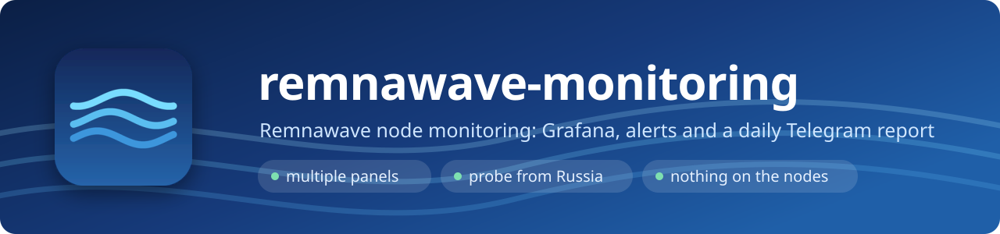
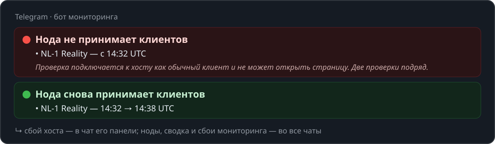
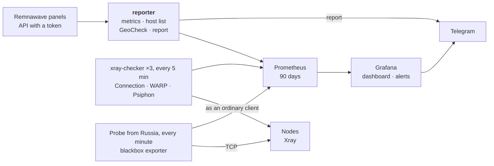

<p align="center">
  
</p>

<p align="center">
  <a href="https://github.com/3APA3A-3AHO3A/remnawave-monitoring/releases/latest"></a>
  <a href="https://github.com/3APA3A-3AHO3A/remnawave-monitoring/actions/workflows/tests.yml"></a>
  <a href="https://github.com/remnawave"></a>
  <a href="https://grafana.com"></a>
  <a href="https://prometheus.io"></a>
  
  <a href="LICENSE"></a>
</p>

<p align="center">
  <a href="#installation">🚀 Install</a> &nbsp;·&nbsp; <a href="#telegram-alerts">🔔 Alerts</a> &nbsp;·&nbsp; <a href="#grafana-dashboard">📊 Dashboard</a> &nbsp;·&nbsp; <a href="#probe-from-russia">🇷🇺 Probe from Russia</a> &nbsp;·&nbsp; <a href="#configuration">⚙️ Configuration</a> &nbsp;·&nbsp; <a href="README.md">🇷🇺 Русский</a>
</p>

Monitoring for [Remnawave](https://docs.rw) nodes: Grafana dashboards, alerts and a daily report in Telegram. One installation watches one or several panels. It runs next to any of the panels with `docker compose`.

> [!NOTE]
> The Telegram messages, the daily report and the Grafana dashboard are in **Russian**. This page is a translation of the [Russian README](README.md).

> [!TIP]
> **Quick start.** A server with Docker → `git clone` → fill in `.env` and `config.toml` → `./apply.sh` → `rwmon check`. Step by step — [Installation](#installation). The first check results show up in 5–10 minutes.

> [!IMPORTANT]
> **Nothing is installed on the nodes.** Panel data comes from the API with a read-only token, and the checks connect to hosts like an ordinary client. All monitoring services listen on `127.0.0.1` only.

## What it looks like

<p align="center">
  
</p>

## Features

- **Telegram alerts** — a host does not accept clients, WARP / Psiphon is down, clients vanished from a node, a panel is unreachable or slow, a host cannot be reached from Russia, a website is down, a certificate is about to expire, a node is overloaded. When things recover, a recovery message follows. Details — [Alerts](#telegram-alerts).
- **Grafana dashboard** — key numbers, a node table with "everything in one row", a card per node, outbounds, panel health, GeoCheck. "Panel" and "Node" selectors.
- **Daily report** — what changed in GeoCheck, failures of the day without duplicates, users, traffic and upcoming server payments per panel. Plus an HTML GeoCheck table.
- **Multiple panels** — each with its own chat and topic. Identical hosts in different panels are checked once.
- **Probe from Russia** — a blackbox exporter on a Russian node reveals IP blocking that is invisible from Europe.
- **Websites and an external watchdog** — checks for your sales site and subscription page, certificate expiry, and a Healthchecks.io ping in case the monitoring server itself goes down.

## How it works



Everything starts with a single `docker compose` and listens on `127.0.0.1` only: the `config` container builds the Prometheus, Grafana and checker configs from `config.toml`, Grafana is exposed through nginx. The probe from Russia is optional, in the `probe/` folder.

- `reporter` gets all panel data through the API with a token, so a second panel needs neither its own domain nor access to its `/metrics`.
- Host checks are done by [xray-checker](https://github.com/kutovoys/xray-checker). The image is built locally from v1.3.1 with two small patches (see [`checker/Dockerfile`](checker/Dockerfile)):
  - Hysteria2 with Salamander `packetSize` support;
  - retries: a single random failure (e.g. a dropped WARP connection) is not counted as an outage.

  The first build takes a few minutes.
- GeoCheck is run by the panel itself on every node, just like the GeoCheck button in a node card.
- `reporter` is written in Python with no external dependencies.

**Traffic.**

- A check is just a connection setup and a tiny response. Three checks every 5 minutes add up to about 100 MB per host per month.
- GeoCheck once a day takes a few MB per node; that traffic is spent by the node itself.

## Documentation

<details>
<summary><b>🔔 Telegram alerts</b></summary>

### Telegram alerts

A message lists the affected nodes, and once everything is fixed a recovery message arrives. While something is still down, a reminder comes every `repeat_minutes` (60 min); for certificates — once a day.

| Alert | How it is detected | Sent to |
|---|---|---|
| Host does not accept clients | the check connects to the host like an ordinary client and cannot open a page. After the arrow the message names the node the host leads to: "LTE 3 · OVRO → CDN 1". All hosts of one node down — the node is the problem, one host down — its path to the node | the chat of the host's panel |
| WARP / Psiphon is down | an address that the node's routing sends to WARP or Psiphon does not open through the node | the chat of the host's panel |
| Clients vanished from a node | the node is connected to the panel, an hour ago it had users, now almost nobody. Looks like IP blocking | all chats |
| Outbound not responding | clients send requests to an outbound (e.g. `psiphon-out`) but almost no responses come back. **Disabled** (paused in Grafana): the outbounds sit behind balancers with a fallback, and uploading a file looks the same as a failure. A real chain failure is caught by the WARP / Psiphon checks | — |
| Panel API unreachable | the panel does not respond, wrong address or token | all chats |
| Panel is slow | a panel process (api, scheduler or processor) responds slower than `panel_lag_ms` (200 ms) for 5 minutes | all chats |
| Panel process restarted | the process uptime was reset — a panel update or a crash | all chats |
| Panel uses too much memory | a panel process uses more than `panel_memory_mb` (1024 MB) for 15 minutes | all chats |
| Host unreachable from Russia | none of the probes in Russia can connect to the host — looks like IP blocking | the chat of the host's panel |
| Website down / from Russia | a page from `[[site]]` does not respond from the monitoring server or from the probes in Russia | all chats |
| Certificate expires soon | the site has less than 14 days left | all chats |
| Node overloaded | load above 0.9 per core or more than 90% memory used for 15 minutes | all chats |
| Hosts are not checked | the host exists in the panel but the checker does not see it (e.g. xray-checker failed to load the list) | all chats |
| reporter / host checks not working | the monitoring itself is broken | all chats |

A node disconnecting from the panel is not tracked here: Remnawave sends a webhook for that itself.

</details>

<details>
<summary><b>📊 Grafana dashboard</b></summary>

### Grafana dashboard

"Panel" and "Node" selectors at the top:

- key numbers: clients, nodes, failing hosts, server network speed, traffic, subscriptions;
- node table — everything about a node in one row: link to the panel, online users and a sparkline, Connection/WARP/Psiphon and "from Russia" checks, server and Xray uptime, Xray version, CPU, RAM, RX/TX, traffic and limit;
- what is broken right now, panel state (API, version, uptime since the last restart, latency) and websites;
- three shared charts: clients, network of all nodes (receive up, send down), outbounds;
- "Each node separately" — a card per node: server receive and send;
- "Outbounds per node" (collapsed) — the same cards, but only traffic through the outbounds from the "Outbound" filter (WARP, Psiphon): you can see on which node an outbound stopped responding;
- collapsed blocks:
  - "Node comparison" — all selected nodes on one chart (clients, traffic, CPU, memory, outbounds, latency) to spot the odd one out;
  - "Panel health" — memory, latency and uptime of the panel's own processes;
  - "Host checks" — "host × panel" tables and failure history;
  - "Probe from Russia";
  - "GeoCheck" — which country each service sees, access to Netflix/ChatGPT and so on, GeoIP databases, IP type and risk.

The dashboard is generated by [`grafana/dashboard.py`](grafana/dashboard.py) — edit it there, then run `python3 grafana/dashboard.py`.

</details>

<details>
<summary><b>📰 Daily report</b></summary>

### Daily report

At the configured time the daily report goes to all chats:

- what changed in GeoCheck (e.g. "Google used to see the node as FI, now RU"). "Needs attention" lists only what is new since yesterday, everything unchanged is a single line; Russian nodes and services from `routed_services` are not highlighted;
- failures of the day: one server in two panels — one line, failures shorter than `short_minutes` (2 min) — one line "and N more short ones", minutes when the probe from Russia could not reach a third of the hosts at once count as a probe failure, not a host failure;
- per panel: users, new and expired during the day, peak clients and traffic per node, upcoming server payments.

An HTML file with the full GeoCheck table for all nodes is attached to the report.

</details>

<details>
<summary><b>✅ Requirements and panel preparation</b></summary>

### Requirements

- Remnawave 3.3 or newer: GeoCheck through the API is required.
- Docker with the compose plugin.
- A Telegram bot and a chat (or a group with topics) the bot can post to. Each panel can have its own chat.

### Preparation in every panel

1. **API token.** Panel → Settings → API tokens. Read permissions only:
   - Nodes: Get nodes;
   - Users: Get user by username;
   - Subscriptions: Get Raw Subscription by Short UUID, Get connection keys by user id;
   - Connections: Request Geocheck for Node, Get Geocheck for Node by Job ID;
   - System: Get Stats, Get Nodes Metrics, Get Stats Digest, Get Remnawave Information;
   - optionally Infra Billing: Get infra billing nodes — then the report shows upcoming payments.
2. **A service user**, e.g. `monitoring`:
   - no traffic limit and no expiry date;
   - in the squads that contain the hosts to check.
3. **Tags on the hosts** to check:
   - `MONITORING` — all three checks: one direct host per node;
   - `MONITORING_LITE` — only "Connection", a single light check. Good for hosts with a traffic limit (LTE, CDN chains): 5–15 KB per check, 50–130 MB per month. The tag name is set in `host_tag_lite`.

   Do not tag balancers and "auto-select" hosts.
4. **Node routing.** The checks go through the node's real Xray config:
   - "Connection" opens `https://www.google.com/generate_204`, this address must go to `DIRECT`;
   - "WARP" opens `https://icanhazip.com` — a domain from `geosite:category-ip-geo-detect`;
   - "Psiphon" opens `http://ip-api.com/…`. The node template needs a rule **above** the WARP rule:
     ```json
     { "domain": ["domain:ip-api.com"], "outboundTag": "psiphon-out" }
     ```

   The addresses can be changed in `config.toml`, section `[checks]`.

</details>

<details>
<summary><b>🚀 Installation</b></summary>

### Installation

#### Preparing the monitoring server

The checks hold one port per host on `127.0.0.1`: 21000+, 22000+ and 23000+. If the system hands out the same ports to outgoing connections, one day a check will fail to start ("address already in use") and stop seeing new hosts. Reserve the ports for the checks — it affects nothing else:

```bash
echo 'net.ipv4.ip_local_reserved_ports = 21000-21999,22000-22999,23000-23999' | sudo tee /etc/sysctl.d/90-rwmon.conf
sudo sysctl -p /etc/sysctl.d/90-rwmon.conf
```

`check` tells you whether your server needs this.

#### Launch

```bash
cd /opt/remnawave
git clone https://github.com/3APA3A-3AHO3A/remnawave-monitoring.git monitoring
cd monitoring
cp .env.example .env && chmod 600 .env                     # ports and Grafana login
cp config.example.toml config.toml && chmod 600 config.toml  # panels, Telegram, checks
nano .env
nano config.toml

./apply.sh
docker compose exec reporter python -m rwmon check
```

For every panel `check` verifies:

- the API;
- the service user and the hosts;
- the bot;

and separately — the metrics in Prometheus. The first host check results show up in 5–10 minutes.

Put passwords containing `$` in single quotes in `.env`: `GRAFANA_ADMIN_PASSWORD='pa$$word'`.

</details>

<details>
<summary><b>⚙️ Configuration — config.toml and .env</b></summary>

### Configuration

**`config.toml`** — everything about the panels. Every field is described in [`config.example.toml`](config.example.toml) (comments in Russian).

One panel — one `[[panel]]` block:

| Field | What it is |
|---|---|
| `id`, `title` | a short Latin id (label on charts) and a human-readable title |
| `api_url`, `api_token` | a panel on the same server — `http://127.0.0.1:3000`, another one — its domain |
| `monitor_user`, `host_tag`, `host_tag_lite` | whose subscription and which hosts to check |
| `host_suffix` | a suffix for host names so hosts of different panels don't get mixed up. Empty for the first panel, " · title" for the others |
| `exclude_nodes` | nodes (names or tags) not to watch. Nodes disabled in the panel are hidden automatically |
| `geocheck_exclude` | nodes where GeoCheck is not run |
| `host_exit` | where a host leads, for alerts: `{ "LTE 3" = "CDN 1" }`. Only needed for hosts behind Cloudflare or a relay — when the host address matches a node IP, the node is found automatically |
| `metrics_url` and login | optional, exact traffic from the panel's `/metrics` (see below) |
| `[panel.telegram]` | the panel's bot, chat and topic |

Shared sections:

- `[schedule]` — time of GeoCheck and the report (UTC);
- `[checks]` — interval, number of attempts and check addresses;
- `[alerts]` — thresholds for "clients vanished", "panel is slow / uses too much memory", the outbound list and how often to remind (`repeat_minutes`);
- `[geocheck]` — which countries to highlight and which services do not use the node's IP (`routed_services`);
- `[report]` — what counts as a short failure in the report and how many minutes the panel API may stay silent;
- `[healthcheck]` — the external watchdog.

After any change run `./apply.sh`: it rebuilds the configs and restarts the containers. Chart history is kept.

**`.env`** — Docker only: ports, domain and the first Grafana login.

**Exact traffic.** The panel API returns traffic already rounded ("12.34 GiB"). That is enough for charts and the report. The "outbound not responding" alert (currently paused) needs exact counters. If the panel is on the same server, point to its `/metrics`:

```toml
metrics_url = "http://127.0.0.1:3001/metrics"   # METRICS_PORT from the panel's .env
metrics_user = "…"                               # METRICS_USER
metrics_password = "…"                           # METRICS_PASS
```

For panels without `metrics_url` this alert simply never fires.

**Identical hosts in different panels** (the link matches except for the name — e.g. panels share nodes through a UUID mapper) are checked once. The result counts for every panel that has the host, and a failure goes to the chats of all those panels. `rwmon links` shows which hosts are checked together.

**Exact traffic for a panel on another server.** Expose its `/metrics` through nginx on the panel's own domain, on a secret path and with a password:

```nginx
location /secret-path/metrics {
    proxy_pass http://127.0.0.1:3001/metrics;   # METRICS_PORT from the panel's .env
}
```

```toml
metrics_url = "https://panel.example.com/secret-path/metrics"
metrics_user = "…"        # METRICS_USER — the password is checked by the panel itself
metrics_password = "…"    # METRICS_PASS
```

**Where messages go:**

- host failures — to the chat of the panel that owns the host;
- everything else (nodes, the report, monitoring failures) — to all chats.

If two panels share a chat, a message arrives there once.

</details>

<details>
<summary><b>🌐 Websites and the external watchdog</b></summary>

### Websites and the external watchdog

**Websites** (`[[site]]` in `config.toml`) — once a minute reporter opens the page and checks the response code, response time, a keyword (if set) and the certificate expiry. Handy for your sales site, subscription page, panel domain:

```toml
[[site]]
name = "Site"
url = "https://example.com"
keyword = "Buy"      # optional
```

If the site root is closed and returns 404/502 (typical for a subscription page), add `any_status = true` — then any HTTP response means "the server is alive". More precise is to use the service user's subscription link: then it checks that the subscription is actually served. Probes from Russia use the `http_any` module for `any_status` — after updating, run `git pull && docker compose restart` on the Russian nodes.

**External watchdog.** If the monitoring server itself goes down, it won't tell you. Use [Healthchecks.io](https://healthchecks.io) for that (free):

1. A "monitoring" check: period 5 minutes, grace 10 minutes. Its URL goes into `[healthcheck] ping_url`: reporter pings it by itself.
2. For a service on another server (a bot, a website): one more check and a cron line on that server, for example
   `*/5 * * * * systemctl is-active --quiet mybot && curl -fsS -m 10 https://hc-ping.com/<uuid> >/dev/null`
   — the ping is sent only while the process is running.

Healthchecks.io can send notifications to Telegram.

</details>

<details>
<summary><b>🇷🇺 Probe from Russia</b></summary>

### Probe from Russia

From Russia you see what is invisible from Europe: for example, a node's IP being blocked. A [blackbox exporter](https://github.com/prometheus/blackbox_exporter) is installed on a Russian node, and the monitoring Prometheus asks it once a minute to open every host (a TCP connection to the IP:port from the subscription) and every website. reporter keeps the address list up to date by itself.

On the Russian node:

```bash
git clone https://github.com/3APA3A-3AHO3A/remnawave-monitoring.git /opt/rwmon-probe
cd /opt/rwmon-probe/probe
./install.sh <monitoring server IP>
```

The script creates a self-signed certificate and a password, starts the container, opens port 9115 in ufw only for the monitoring IP and prints a `[[probe]]` block — paste it into the monitoring `config.toml` and run `./apply.sh`.

UDP hosts (Hysteria2, TUIC, WireGuard) are not probed: a TCP connection to their port does not open even when everything works.

There can be several probes. The "unreachable from Russia" alert fires only if the host fails from all of them: a random problem on one Russian node does not cause false alarms. Mobile whitelists and the behaviour of specific carriers cannot be checked this way — the probe sits in a data center.

</details>

<details>
<summary><b>🔐 Access to Grafana</b></summary>

### Access to Grafana

Grafana listens on `127.0.0.1:3300` only. There are two ways to open it.

**Through an SSH tunnel**, no domain needed:

```powershell
ssh -L 3300:127.0.0.1:3300 user@server
# in the browser: http://localhost:3300
```

**Through nginx on a subdomain.** Use [`nginx/grafana.conf.example`](nginx/grafana.conf.example) as a starting point.

- The example already rate-limits login attempts.
- Grafana itself also locks an account after 5 wrong passwords.
- Sign-up and anonymous access are disabled.

**View-only access.** Administration → Users and access → Users → "New user", then set the organization role to **Viewer** in the user card. Such a user sees the dashboards but cannot change them, the alerts or Telegram. Do not use a public link ("Share externally"): it opens the dashboard without a password, and the "Panel" and "Node" selectors don't work there.

**Tip.** Use a wildcard certificate or the Cloudflare proxy for the subdomain. A separate Let's Encrypt certificate ends up in public logs, and scanners find a "secret" subdomain within minutes.

`GRAFANA_ADMIN_USER` and `GRAFANA_ADMIN_PASSWORD` apply only on the first start. After that the password is changed in Grafana itself: profile → Change password.

</details>

<details>
<summary><b>💾 Disk space</b></summary>

### Disk space

- **Prometheus history** is kept for 90 days (`PROMETHEUS_RETENTION`) and no more than 2 GB (`PROMETHEUS_RETENTION_SIZE`) — whichever comes first. Usually it is a few hundred MB.
- **Container logs** — no more than 30 MB per container (3 files of 10 MB), old ones are removed automatically.
- **GeoCheck** keeps 60 days of history and one image per node.
- **Image builds.** `./apply.sh` removes old versions of the images, but the Docker build cache grows. Check it: `docker system df`, clean cache older than a week: `docker builder prune -f --filter until=168h`.

</details>

<details>
<summary><b>🧰 Commands and updates</b></summary>

### Commands

```bash
docker compose exec reporter python -m rwmon check              # check the configuration
docker compose exec reporter python -m rwmon links              # which hosts are checked
docker compose exec reporter python -m rwmon report --dry-run   # show the report without sending
docker compose exec reporter python -m rwmon report             # send the report now
docker compose exec reporter python -m rwmon geocheck --send    # GeoCheck + report now

docker compose logs -f reporter                                 # log
git pull && ./apply.sh                                          # update
```

What changed in a new version — see [`CHANGELOG.md`](CHANGELOG.md) (in Russian) and the [releases](https://github.com/3APA3A-3AHO3A/remnawave-monitoring/releases) page.

If the containers were started after the report time, today's GeoCheck and report run right after startup. After that — daily on schedule.

</details>

<details>
<summary><b>↗️ Migrating from the single-panel version</b></summary>

### Migrating from the single-panel version

All settings used to live in `.env`. The `migrate` command moves them to `config.toml`, including access to the panel's `/metrics`:

```bash
cd /opt/remnawave/monitoring
cp .env .env.bak
git pull
docker compose build reporter
docker run --rm --env-file .env rwmon-reporter:local migrate > config.toml
chmod 600 config.toml
nano config.toml        # review; add a second panel if needed
./apply.sh
```

After that `.env` only needs the lines from [`.env.example`](.env.example). The rest can be removed.

</details>

<details>
<summary><b>🧪 Development</b></summary>

### Development

- reporter tests: `cd reporter && python -m unittest discover -v tests` (Python 3.13, no external dependencies).
- The dashboard is not edited by hand: change [`grafana/dashboard.py`](grafana/dashboard.py) and rebuild the JSON — `python3 grafana/dashboard.py`. CI checks that `grafana/dashboards/` matches the script's output.
- CI ([`tests.yml`](.github/workflows/tests.yml)) on every push and PR: reporter tests, dashboard build, `docker-compose.yml` validation and the xray-checker image build with patches.
- [Dependabot](.github/dependabot.yml) opens weekly PRs for new image versions (Prometheus, Grafana, blackbox exporter, base images) and GitHub Actions.
- [`xray-checker-release.yml`](.github/workflows/xray-checker-release.yml) checks xray-checker releases weekly: if the patches apply to a new version it opens a PR, otherwise an issue.
- Release: add a section to [`CHANGELOG.md`](CHANGELOG.md), then `git tag vX.Y.Z` and `git push origin vX.Y.Z` — [`release.yml`](.github/workflows/release.yml) creates a release with the text from the CHANGELOG.

</details>

## License

MIT — see [LICENSE](LICENSE).
