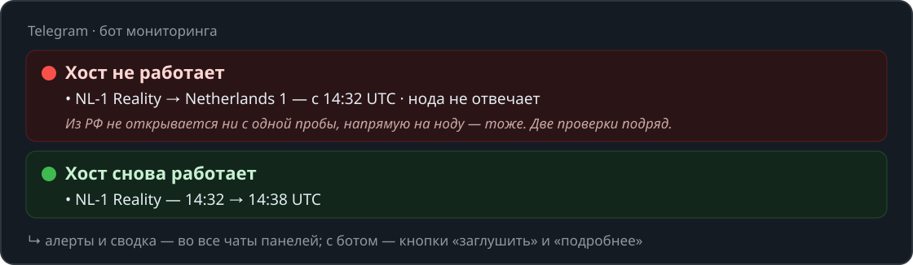
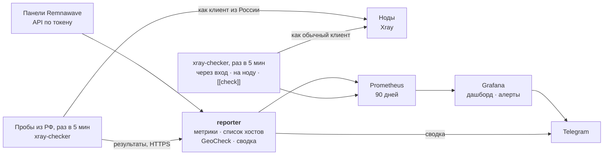

<p align="center">
  
</p>

<p align="center">
  <a href="https://github.com/3APA3A-3AHO3A/remnawave-monitoring/releases/latest"></a>
  <a href="https://github.com/3APA3A-3AHO3A/remnawave-monitoring/actions/workflows/tests.yml"></a>
  <a href="https://github.com/remnawave"></a>
  <a href="https://grafana.com"></a>
  <a href="https://prometheus.io"></a>
  
  <a href="LICENSE"></a>
</p>

<p align="center">
  <a href="#установка">🚀 Установка</a> &nbsp;·&nbsp; <a href="#алерты-в-telegram">🔔 Алерты</a> &nbsp;·&nbsp; <a href="#дашборд-grafana">📊 Дашборд</a> &nbsp;·&nbsp; <a href="#проверка-из-рф">🇷🇺 Проверка из РФ</a> &nbsp;·&nbsp; <a href="#настройки">⚙️ Настройки</a> &nbsp;·&nbsp; <a href="README.en.md">🇬🇧 English</a>
</p>

Мониторинг нод [Remnawave](https://docs.rw): графики в Grafana, алерты и ежедневная сводка в Telegram. Одна установка следит за одной или несколькими панелями. Ставится рядом с любой из панелей через `docker compose`.

> [!TIP]
> **Быстрый старт.** Сервер с Docker → `git clone` → заполнить `.env` и `config.toml` → `./apply.sh` → `rwmon check`. Подробно — в разделе [Установка](#установка). Первые результаты проверок появятся через 5–10 минут.

> [!IMPORTANT]
> **На ноды ничего не ставится.** Данные о панелях берутся из API по токену с правами только на чтение, а проверки подключаются к хостам как обычный клиент. Все сервисы мониторинга слушают только `127.0.0.1`.

## Как это выглядит

<p align="center">
  
</p>

## Возможности

- **Алерты в Telegram** — хост не работает (с причиной: блокировка в РФ, сломан вход, нода не отвечает), не работает проверка маршрута (WARP, Psiphon, каскад — какие опишете в `[[check]]`) или трафик вышел не там, клиенты пропали с ноды, панель недоступна или тормозит, сайт лёг, сертификат скоро истекает, нода перегружена. Когда всё починится, придёт сообщение о восстановлении. Подробнее — [Алерты](#алерты-в-telegram).
- **Дашборд Grafana** — главные цифры, что не работает прямо сейчас, таблица хостов (итог и все проверки в одной строке), таблица нод, карточка на каждую ноду, аутбаунды, блокировки РКН, здоровье панелей, GeoCheck. Переключатели «Панель» и «Нода».
- **Ежедневная сводка** — что изменилось в GeoCheck, сбои за сутки без дублей, пользователи и трафик по каждой панели. Плюс HTML-таблица GeoCheck.
- **Проверки маршрутов из настроек** — блоки `[[check]]`: что открыть через хост и где должен оказаться выход (не с IP ноды, с IP ноды, в стране, в сети). Хосты выбираются по профилю ноды. Подробнее — [Проверки маршрутов](#проверки-маршрутов).
- **Несколько панелей** — у каждой свой чат и топик. Одинаковые хосты в разных панелях проверяются один раз.
- **Проверка из РФ** — пробы на серверах в России подключаются к каждому хосту как приложение клиента: видно, работает ли хост у клиентов в России. Сервер мониторинга проверяет тот же хост через вход и напрямую на ноду — так понятно, где сломалось. Подробнее — [Проверка из РФ](#проверка-из-рф).
- **Блокировки РФ** — раз в несколько часов IP всех нод и домены сервиса проверяются по спискам блокировок через [cheburcheck.ru](https://cheburcheck.ru): реестр РКН, заблокированные подсети и CDN. С API-токеном — ещё и сканерами cheburcheck внутри сетей операторов РФ: видно, у каких провайдеров адрес режут ТСПУ, по SNI или подменой DNS. Подробнее — [Блокировки РФ](#блокировки-рф).
- **Серверы нод** — по желанию: диск, swap, таблица соединений и занятость процессора по [node_exporter](https://github.com/prometheus/node_exporter) на нодах. Подробнее — [Серверы нод](#серверы-нод).
- **Сайты и внешний сторож** — проверка сайта продаж и страницы подписки, срок сертификата, отметка в Healthchecks.io на случай, если упадёт сам мониторинг.

## Как устроено



Всё запускается одним `docker compose` и слушает только `127.0.0.1`: контейнер `config` собирает конфиги Prometheus, Grafana и проверок из `config.toml`, Grafana открывается наружу через nginx. Наружу открыт только порт для проб из РФ (9116, HTTPS с паролем пробы) — если пробы есть. Пробы ставятся отдельно, папка `probe/`.

- Все данные о панелях `reporter` берёт через API по токену. Поэтому для второй панели не нужен ни отдельный домен, ни доступ к её `/metrics`.
- Проверки хостов делает [xray-checker](https://github.com/kutovoys/xray-checker). Образ собирается локально из v1.3.1 с четырьмя небольшими патчами (см. [`checker/Dockerfile`](checker/Dockerfile)):
  - поддержка Hysteria2 с Salamander `packetSize`;
  - повторные попытки: одна случайная неудача (например, обрыв соединения WARP) не считается сбоем;
  - IP выхода и причина сбоя в метриках (`xray_proxy_exit_ip`, `xray_proxy_error_code`): по IP видно, что запрос ушёл напрямую, мимо WARP или Psiphon, а причина (таймаут, обрыв, отказ, TLS, DNS) попадает в сообщение алерта;
  - переходник на новое API libxray — чтобы собирать со свежими xray-core и библиотеками без известных уязвимостей.

  Первая сборка занимает несколько минут.
- GeoCheck запускает сама панель на каждой ноде, как кнопка GeoCheck в карточке ноды.
- `reporter` написан на Python без внешних зависимостей.

**Трафик.**

- Одна проверка — это установка соединения и крошечный ответ: около 30 МБ в месяц на хост при проверке раз в 5 минут. Хост проверяется с каждой пробы из РФ, с сервера мониторинга на ноду (у хостов за прокладкой или CDN — ещё и через вход) и проверками маршрутов: для обычного хоста с двумя пробами и WARP + Psiphon выходит около 150 МБ в месяц.
- GeoCheck раз в сутки тратит несколько МБ на ноду; этот трафик расходует сама нода.

## Документация

<details>
<summary><b>🔔 Алерты в Telegram</b></summary>

### Алерты в Telegram

Сообщение короткое: что случилось, где и почему — по строке на хост или ноду со временем начала и причиной. Когда всё починилось, приходит сообщение о восстановлении. Пояснение к алерту — в Grafana, в карточке правила.

```
🔴 Хост не работает
• 🇷🇺 LTE 3 · FixErrorVPN → CDN 1 — с 16:34 UTC · не работает вход (прокладка, CDN), нода отвечает
```

Причина в строке: у хоста — итог (блокировка в РФ, сломан вход, нода не отвечает, см. [Проверка из РФ](#проверка-из-рф)); у проверок маршрутов — таймаут, обрыв соединения, отказ, ошибка TLS или DNS; «мимо ‹проверки›» — с IP какой ноды вышел запрос; «выход не там» — страна и сеть выхода; у сайта — код ответа или «нет ответа»; у сертификата — сколько дней осталось; «клиенты пропали» — сколько их сейчас; «нода перегружена» — процент CPU или памяти. Причина не входит в метки алерта, поэтому её смена не даёт лишних «восстановилось» и «упало». Пока что-то не работает, напоминание приходит раз в `repeat_minutes` (60 мин), про сертификат — раз в сутки.

| Алерт | Как определяется | Куда |
|---|---|---|
| Хост не работает | итог по хосту не «работает» две проверки подряд: из РФ не открывается ни с одной пробы (хосты МСК-нод — с сервера мониторинга), а причина — по проверкам сервера мониторинга через вход и на ноду. В сообщении после стрелки — нода, куда ведёт хост: «LTE 3 · OVRO → CDN 1» | все чаты |
| «‹проверка› не работает» (WARP, Psiphon…) | через хост не открывается адрес проверки маршрута из `[[check]]` | все чаты |
| Трафик идёт мимо ‹проверки› | `egress = "other"`: адрес открылся, но ответ пришёл с IP одной из нод панелей — запрос ушёл напрямую. Обычно выход упал, а балансировщик переключился на прямой. Если нода выходит в интернет не с того IP, что указан в панели (NAT), этот алерт её не видит | все чаты |
| ‹Проверка›: выход не с IP ноды | `egress = "node"`: ответ пришёл не с IP ноды — трафик ушёл в чужой выход | все чаты |
| ‹Проверка›: выход не там | `egress_country` / `egress_asn`: страна или сеть выхода не те, что ждали (по базе DB-IP Lite) | все чаты |
| Клиенты пропали с ноды | нода подключена к панели, час назад на ней были люди, а теперь почти никого. Похоже на блокировку IP | все чаты |
| Аутбаунд не отвечает | клиенты шлют запросы в аутбаунд (например, `psiphon-out`), а ответов почти нет. **Выключено** (на паузе в Grafana): за выходами стоят балансировщики с резервом, а отправка файла выглядит так же, как поломка. Реальный отказ цепочки ловят проверки маршрутов | — |
| Панель недоступна по API | не отвечает панель, неверный адрес или токен | все чаты |
| Панель тормозит | процесс панели (api, scheduler или processor) 5 минут отвечает с задержкой больше `panel_lag_ms` (200 мс) | все чаты |
| Процесс панели перезапустился | время работы процесса сбросилось. С ботом: если за последние 40 минут сменилась версия панели — это обновление, приходит тихая строка «Панель обновлена до …»; версия та же — падение, алерт со звуком | все чаты |
| Панель ест много памяти | процесс панели 15 минут занимает больше `panel_memory_mb` (1024 МБ) | все чаты |
| Блокировка РФ: адрес в списках | `[rkn]`: IP ноды или домен сервиса попал в реестр РКН, заблокированную подсеть или CDN (по cheburcheck.ru). В сообщении — что именно нашлось | все чаты |
| Блокировка РФ: сканеры видят блок | `[rkn] token`: сканеры cheburcheck в сетях операторов РФ видят блокировку адреса (хотя бы два). В сообщении — вид: ТСПУ, по SNI, подмена DNS; у каких провайдеров — в сводке и на дашборде | все чаты |
| Проба из РФ молчит | проба 10 минут не присылала результаты: итог по хостам пока считается без неё (без всех проб — только по серверу мониторинга) | все чаты |
| Сайт не открывается / из РФ | страница из `[[site]]` не отвечает с сервера мониторинга или с проб в России | все чаты |
| Сертификат скоро истекает | у сайта осталось меньше 14 дней | все чаты |
| Нода перегружена | 15 минут load выше 0,9 на ядро или занято больше 90% памяти | все чаты |
| Geo-базы не обновляются | `[node_exporter]`: geoip.dat или geosite.dat на ноде старше 2 суток (возраст пишет cron `rwmon-geodata` из [fixerror-node](https://github.com/3APA3A-3AHO3A/fixerror-node)). Значит, ядро перестало их обновлять: пропал блок geodata в профиле или нода не видит GitHub | все чаты |
| Хосты не проверяются | хост есть в панели, но проверка его не видит (например, xray-checker не смог загрузить список) | все чаты |
| reporter / проверка хостов не работает | сломался сам мониторинг | все чаты |

Отключение ноды от панели здесь не отслеживается: Remnawave сама шлёт об этом вебхук.

#### Бот с кнопками (`[bot]`)

С блоком `[bot]` алерты шлёт свой бот мониторинга, и у каждого сообщения появляются кнопки:

- **🔕 1 ч / 6 ч / 24 ч** и **Отключить навсегда** — тишина для хостов из этого сообщения. Сообщение обновляется во всех чатах: «Заглушено до 05:20 — Alex» и кнопка «Вернуть уведомления». Тишина общая для всех чатов: если заглушил один админ, видят все. Сбои других хостов по тому же правилу приходят как обычно;
- **Подробнее** — в том же сообщении: правило, когда началось, сколько длится, причина, адрес, сколько за сутки не проходила проверка, что делать. «Назад» возвращает алерт;
- **Открыть в Grafana** — если Grafana открывается по домену (`GRAFANA_DOMAIN`).

Команды (только для `admins`):

| Команда | Что показывает |
|---|---|
| `/status` | ноды по панелям, сколько хостов работает, пробы из РФ на связи, хосты по каждой проверке сервера мониторинга, сайты, РКН, сколько алертов горит; «Что горит» — список с отметкой заглушённых |
| `/mutes` | что заглушено, до когда и кем; вернуть по одному или всё |
| `/work` | режим работ на час: алерты приходят без звука и с пометкой «Идут работы», в сводке это время отмечено, чтобы перезапуски не читались как сбои; кнопки «+1 час» и «Завершить работы» |
| `/settings` | включить или выключить группы алертов (ноды и хосты, пробы из РФ, РКН, панели, сайты и сертификаты, сам мониторинг) и ежедневную сводку; как часто напоминать, пока не починили (30 мин – 6 ч); тихие часы — сообщения приходят без звука |

Сообщения — rich-сообщения Telegram (таблицы, раскрывающиеся блоки, время в часовом поясе читателя). Если клиент или Telegram их не принял, то же уходит обычным сообщением с кнопками. Тишина и настройки хранятся у reporter (`bot.json` в его томе) и переживают перезапуск; Grafana при этом видит все алерты как есть.

Боту нужен свой токен: кнопки он получает через `getUpdates`, а два слушателя одного бота отнимают друг у друга нажатия. Бот панели или IP Limiter не подойдёт; бот, который только отправляет (например, бэкапов), — подойдёт. `rwmon check` покажет, если у бота настроен webhook.

</details>

<details>
<summary><b>📊 Дашборд Grafana</b></summary>

### Дашборд Grafana

Сверху переключатели «Панель», «Нода» и «Аутбаунд»:

- цифры: пользователи онлайн и подписки, ноды на связи, хосты работают / не работают, пробы из РФ на связи, сеть серверов сейчас, трафик клиентов в обе стороны;
- «Сейчас не работает» — хост, что именно (блокировка в РФ, сломан вход, нода не отвечает, не работает WARP…) и сколько уже; рядом пробы из РФ (на связи, сколько хостов проверяют, сколько не открылось) и панели (API, версия, без рестарта, задержка);
- сайты (с сервера мониторинга и из РФ, код, время ответа, сертификат) и блокировки РКН;
- «Хосты» — строка на хост: итог, результат с каждой пробы из РФ, с сервера мониторинга через вход и на ноду, проверки маршрутов, время ответа из РФ, куда ведёт хост; под ней — история итога по времени;
- «Ноды» — строка на ноду: связь, онлайн и пик, CPU, RAM, диск и conntrack (с `[node_exporter]`), RX/TX, трафик, лимит, сколько работают сервер и Xray, версия Xray;
- три общих графика: клиенты, сеть всех нод (приём вверх, отправка вниз), аутбаунды;
- «Каждая нода отдельно» — карточка на ноду: приём и отдача сервера;
- свёрнутые блоки:
  - «Выходы по нодам» — такие же карточки, но только трафик через выходы из фильтра «Аутбаунд» (WARP, Psiphon): видно, на какой ноде выход перестал отвечать;
  - «Сравнение нод» — все выбранные ноды на одном графике (клиенты, трафик, CPU, память, аутбаунды);
  - «Серверы нод» — если включён `[node_exporter]`: таблица и графики CPU, памяти, swap, диска и таблицы соединений;
  - «Проверки подробно» — история и время ответа из РФ и с сервера мониторинга по каждому хосту;
  - «Здоровье панелей» — память, задержка и время работы процессов самой панели;
  - «GeoCheck» — IP, сеть и риск, какую страну видит каждый сервис, доступ к Netflix/ChatGPT и т.п., GeoIP-базы.

Дашборд собирается скриптом [`grafana/dashboard.py`](grafana/dashboard.py) — править удобнее там, потом `python3 grafana/dashboard.py`.

</details>

<details>
<summary><b>📰 Ежедневная сводка</b></summary>

### Ежедневная сводка

Ежедневная сводка в заданное время уходит во все чаты:

- что изменилось в GeoCheck (например, «Google видел ноду как FI, теперь RU»). «Требует внимания» — только новое со вчера, то, что не менялось, — одной строкой; RU-ноды и сервисы из `routed_services` не подсвечиваются;
- сбои за сутки: один сервер в двух панелях — одной строкой, сбои до `short_minutes` (2 мин) — одной строкой «и ещё N коротких»; у хоста — итог: не открывался из РФ, не работал вход, нода не отвечала; если проба из РФ молчала дольше 5 минут — отдельной строкой;
- по каждой панели: пользователи, новые и истёкшие за сутки, пик клиентов и трафик по нодам.

С ботом (`[bot]`) сводка начинается с итога: «✅ Всё в порядке» или «⚠️ Требует внимания» со списком — не открываются сайты, адрес в списках блокировок или его блокируют сканеры, нода перегружалась дольше 15 минут за сутки, geo-базы не обновляются, нужна перезагрузка после обновлений, сертификат меньше чем на 30 дней, новые проблемы GeoCheck. Окна режима работ — отдельной строкой. Дальше коротко: таблица панелей (онлайн, за сутки, трафик к клиентам ↓ и от клиентов ↑), сбои одной строкой с самым долгим, сайты и ближайший сертификат, GeoCheck и РКН. Подробности — в раскрывающихся блоках: ноды каждой панели (клиенты сейчас / пик, ↓, ↑, аутбаунды), сбои списком, GeoCheck и блокировки. Заглушённая в боте блокировка РКН в счёт не идёт. Выключить сводку можно в `/settings`.

К сводке прикладывается один HTML-отчёт за сутки: карточки с главными цифрами, лента сбоев по времени, ноды каждой панели с трафиком клиентов в обе стороны, аутбаундами и сетью сервера (принято / отправлено), GeoCheck (страна по сервисам, изменения, недоступные сервисы, полная таблица и разбор по каждой ноде — свёрнуто), сайты с сертификатами и блокировки РКН. Отчёт подстраивается под светлую и тёмную тему.

</details>

<details>
<summary><b>✅ Требования и подготовка панелей</b></summary>

### Требования

- Remnawave 3.3 или новее: нужен GeoCheck через API.
- Docker с плагином compose.
- Telegram-бот и чат (или группа с топиками), куда бот может писать. У каждой панели может быть свой чат.

### Подготовка в каждой панели

1. **API-токен.** Панель → Настройки → API-токены. Нужны только права на чтение:
   - Users: Get user by username — служебный пользователь, от имени которого идут проверки;
   - Subscriptions: Get Raw Subscription by Short UUID — теги хостов: какие хосты проверять;
   - Nodes: Get nodes — ноды, их страны и статус;
   - Hosts: Get hosts и Config Profiles: Get config profiles — нода и порт входа хоста: хосты за прокладкой или CDN проверяются ещё и напрямую на ноде, проверки маршрутов выбирают хосты по имени профиля (`profiles`). Без них хосты проверяются только через вход, а в `profiles` работают UUID;
   - Connections: Request Geocheck for Node, Get Geocheck for Node by Job ID — GeoCheck;
   - System: Get Stats, Get Nodes Metrics, Get Stats Digest — пользователи, клиенты и трафик нод, сводка; Get Remnawave Information, Get Remnawave Health — версия и состояние самой панели.
2. **Служебный пользователь**, например `monitoring`:
   - без лимита трафика и без срока окончания;
   - в сквадах, где есть проверяемые хосты;
   - если в панели включён HWID — со свободным местом под одно устройство: мониторинг берёт подписку как устройство `rwmon-<id панели>`.

   Хосты мониторинг берёт из подписки этого пользователя в формате **Xray JSON** — так же, как её получают приложения, вместе с мапперами хостов. Поэтому проверяемые хосты должны быть видимыми и не исключёнными из типа «Xray JSON». Base64 для мониторинга не нужен.
3. **Теги на хостах**, которые нужно проверять:
   - `MONITORING` — проверка хоста (из РФ, через вход, на ноду) и проверки маршрутов, которые подходят хосту: по одному прямому хосту на ноду;
   - `MONITORING_LITE` — только проверка хоста, без проверок маршрутов. Подходит для хостов с лимитом трафика (LTE, цепочки через CDN): 5–15 КБ за проверку, 50–130 МБ в месяц. Имя тега задаётся в `host_tag_lite`.
   - `MONITORING_NO_<ID>` (например, `MONITORING_NO_PSIPHON`) — ставится **рядом** с `MONITORING` и снимает с хоста одну проверку маршрута, если ему она не нужна, а профиль ноды её назначает. Имя тега — `skip_tag` проверки. Обычно удобнее выбирать хосты по профилю (см. [Проверки маршрутов](#проверки-маршрутов)).

   Балансировщики и «автовыбор» не отмечайте.
4. **Роутинг нод.** Проверки идут через настоящий конфиг Xray на ноде:
   - проверка хоста открывает `https://www.google.com/generate_204` (`url_xray` в `[checks]`), этот адрес должен идти в `DIRECT`;
   - проверка маршрута открывает свой `url` — любой адрес, который ваш роутинг уже отправляет в нужный выход и который отвечает IP (например, `https://icanhazip.com` из `geosite:category-ip-geo-detect` для WARP). Если такого адреса нет, добавьте правило на ноде — например, для Psiphon **выше** правила для WARP:
     ```json
     { "domain": ["domain:ip-api.com"], "outboundTag": "psiphon-out" }
     ```

</details>

<details>
<summary><b>🚀 Установка</b></summary>

### Установка

#### Подготовка сервера мониторинга

Проверки держат на `127.0.0.1` по порту на каждый хост: «на ноду» — 21000+, каждая проверка маршрута — следующая тысяча (22000+, 23000+…), «через вход» — 30000+. Если система раздаёт эти же порты исходящим соединениям, проверка однажды не сможет запуститься («address already in use») и перестанет видеть новые хосты. Закрепите порты за проверками — больше это ни на что не влияет (пример для двух проверок маршрутов; `check` подскажет строку под ваши):

```bash
echo 'net.ipv4.ip_local_reserved_ports = 21000-21999,22000-22999,23000-23999,30000-30999' | sudo tee /etc/sysctl.d/90-rwmon.conf
sudo sysctl -p /etc/sysctl.d/90-rwmon.conf
```

`check` сам скажет, нужно ли это на вашем сервере, и напишет строку под ваше число проверок.

#### Запуск

```bash
cd /opt/remnawave
git clone https://github.com/3APA3A-3AHO3A/remnawave-monitoring.git monitoring
cd monitoring
cp .env.example .env && chmod 600 .env                     # порты и вход в Grafana
cp config.example.toml config.toml && chmod 600 config.toml  # панели, Telegram, проверки
nano .env
nano config.toml

./apply.sh
docker compose exec reporter python -m rwmon check
```

`check` проверяет для каждой панели:

- API;
- служебного пользователя и хосты;
- бота;

и отдельно — метрики в Prometheus. Первые результаты проверок хостов появятся через 5–10 минут.

Пароли, в которых есть знак `$`, в `.env` берите в одинарные кавычки: `GRAFANA_ADMIN_PASSWORD='pa$$word'`.

</details>

<details>
<summary><b>⚙️ Настройки — config.toml и .env</b></summary>

### Настройки

**`config.toml`** — всё, что касается панелей. Каждое поле описано в [`config.example.toml`](config.example.toml).

Одна панель — один блок `[[panel]]`:

| Поле | Что это |
|---|---|
| `id`, `title` | короткий латинский id (метка на графиках) и подпись для людей |
| `api_url`, `api_token` | панель на этом же сервере — `http://127.0.0.1:3000`, другая — её домен |
| `monitor_user`, `host_tag`, `host_tag_lite` | чья подписка и какие хосты проверять |
| `host_tag_no_warp`, `host_tag_no_psiphon` | только для старых настроек без `[[check]]`: теги-исключения WARP и Psiphon |
| `host_suffix` | подпись к названиям хостов, чтобы хосты разных панелей не путались. У первой панели пусто, у остальных « · title» |
| `exclude_nodes` | ноды (имена или теги), за которыми не следить. Выключенные в панели ноды скрываются сами |
| `geocheck_exclude` | ноды, где не запускать GeoCheck |
| `host_exit` | куда ведёт хост, для алертов: `{ "LTE 3" = "CDN 1" }`. Нужно только для хостов через Cloudflare или промежуточный сервер — если адрес хоста совпадает с IP ноды, нода находится сама |
| `metrics_url` и логин | необязательно, точный трафик из `/metrics` панели (см. ниже) |
| `[panel.telegram]` | бот, чат и топик панели |

Общие разделы:

- `[schedule]` — время GeoCheck и сводки (UTC);
- `[checks]` — интервал, число попыток, адрес проверки хоста (`url_xray`), порт для проб из РФ (`ru_port`, 9116);
- `[[check]]` — проверки маршрутов, по блоку на проверку (см. ниже);
- `[alerts]` — пороги алертов «клиенты пропали», «панель тормозит / ест много памяти», список аутбаундов и как часто напоминать (`repeat_minutes`);
- `[geocheck]` — какие страны подсвечивать и какие сервисы идут не с IP ноды (`routed_services`);
- `[report]` — что в сводке считать коротким сбоем и сколько минут API панели может молчать;
- `[healthcheck]` — внешний сторож.

После любого изменения выполните `./apply.sh`: он пересоберёт конфиги и перезапустит контейнеры. История графиков сохраняется.

**`.env`** — только Docker: порты, домен и первый вход в Grafana.

**Точный трафик.** В API панели трафик отдаётся уже округлённым («12.34 GiB»). Для графиков и сводки этого хватает. Алерту «аутбаунд не отвечает» (сейчас на паузе) нужны точные счётчики. Если панель на том же сервере, укажите её `/metrics`:

```toml
metrics_url = "http://127.0.0.1:3001/metrics"   # METRICS_PORT из .env панели
metrics_user = "…"                               # METRICS_USER
metrics_password = "…"                           # METRICS_PASS
```

Для панелей без `metrics_url` этот алерт просто не срабатывает.

**Одинаковые хосты в разных панелях** (тот же протокол, сервер, порт, транспорт и ключ Reality; UUID, SNI, отпечаток и название могут отличаться — например, панели делят ноды через маппер UUID) проверяются один раз. Результат засчитывается каждой панели, где есть этот хост, а сбой приходит в каждый чат один раз, от панели, которой принадлежит нода (по IP хоста среди нод всех панелей или по `host_exit`). `rwmon links` показывает, какие хосты проверяются вместе.

**Точный трафик панели на другом сервере.** Откройте её `/metrics` через nginx на том же домене, что и панель, по секретному пути и с паролем:

```nginx
location /секретный-путь/metrics {
    proxy_pass http://127.0.0.1:3001/metrics;   # METRICS_PORT из .env панели
}
```

```toml
metrics_url = "https://panel.example.com/секретный-путь/metrics"
metrics_user = "…"        # METRICS_USER — пароль проверяет сама панель
metrics_password = "…"    # METRICS_PASS
```

**Куда уходят сообщения:**

- все алерты и ежедневная сводка — во все чаты: у каждой панели может быть свой админ, но видеть состояние всех серверов полезно каждому;
- хост, общий для нескольких панелей, даёт в каждый чат одно сообщение, а не по одному от каждой панели. В сообщении стоит панель, которой принадлежит нода.

Если у двух панелей один и тот же чат, сообщение придёт туда один раз.

</details>

<details>
<summary><b>🧭 Проверки маршрутов</b></summary>

### Проверки маршрутов

Встроенная проверка хоста — принимает ли он клиента и выпускает ли в интернет (из РФ, через вход, на ноду; см. [Проверка из РФ](#проверка-из-рф)). Всё остальное — куда должен уходить трафик — описывается блоками `[[check]]` в `config.toml`. У кого-то это WARP и Psiphon, у кого-то каскад через московскую ноду в США, у кого-то ничего: тогда блоков нет.

```toml
[[check]]
id = "warp"                       # латиницей: метка, имя процесса, тег-исключение MONITORING_NO_WARP
title = "WARP"                    # как подписывать в алертах и на дашборде
url = "https://icanhazip.com"     # адрес, который роутинг ноды отправляет в WARP и который отвечает IP
egress_asn = [13335]              # выход должен быть в сети Cloudflare
profiles = ["Default Vless EU", "CDN 1"]   # профили нод, хосты которых проверять

[[check]]
id = "psiphon"
title = "Psiphon"
url = "http://ip-api.com/line/?fields=query"
egress = "other"                  # выход не с IP ноды
profiles = ["Default Vless EU"]
alert = "Через ноду не работает Psiphon: Gemini и NotebookLM не открываются."

[[check]]
id = "usa"
title = "Каскад в США"
url = "https://icanhazip.com"
egress_country = ["US"]
hosts = ["🇺🇸 Америка"]            # один хост по названию вместо профиля
```

| Поле | Что это |
|---|---|
| `id`, `title` | id латиницей (до 20 символов) и подпись. Порядок блоков — порядок колонок на дашборде |
| `url` | что открывать через хост. Для `egress*` адрес должен отвечать IP — как `icanhazip.com` или `ip-api.com/line/?fields=query` |
| `egress` | `"other"` — выход не с IP ноды (ловит «упал выход, трафик ушёл напрямую»); `"node"` — выход с IP ноды; не задано — достаточно, что открылось |
| `egress_country`, `egress_asn` | страны (ISO) и сети (номера AS) выхода. Узнаются по бесплатной базе [DB-IP Lite](https://db-ip.com) (CC BY 4.0), её reporter сам скачивает раз в месяц в `data/geoip` |
| `profiles` | конфиг-профили нод (имя или UUID): проверяются хосты, которые ведут на ноды этих профилей. Нода находится по IP хоста или по `host_exit`. Новая нода профиля попадает под проверку сама |
| `hosts` | названия хостов — в дополнение к профилям или вместо них |
| `skip_tag` | тег, который снимает проверку с хоста; по умолчанию `MONITORING_NO_<ID>` |
| `alert` | пояснение к алерту (видно в Grafana, в карточке правила) |

Без `profiles` и `hosts` проверка идёт на всех хостах с `MONITORING`. Лёгкие хосты (`MONITORING_LITE`) проверки маршрутов не проходят. Проверок может быть до 8; на каждую — свой процесс xray-checker, колонка дашборда, строка сводки и алерты. После правки — `./apply.sh`.

**Переход с 1.x.** Если блоков `[[check]]` нет, работают прежние WARP и Psiphon из `url_warp` / `url_psiphon` с `egress = "other"` и тегами `MONITORING_NO_WARP` / `MONITORING_NO_PSIPHON` — как в 1.x, конфиг менять не обязательно. Готовые блоки для ваших нынешних проверок печатает:

```bash
docker compose exec reporter python -m rwmon migrate-checks
```

Вставьте их в `config.toml`, при желании замените теги-исключения на `profiles` и выполните `./apply.sh`.

</details>

<details>
<summary><b>🌐 Сайты и внешний сторож</b></summary>

### Сайты и внешний сторож

**Сайты** (`[[site]]` в `config.toml`) — раз в минуту reporter открывает страницу и смотрит код ответа, время ответа, ключевое слово (если задано) и срок сертификата. Так удобно следить за сайтом продаж, страницей подписки, доменом панели:

```toml
[[site]]
name = "Сайт"
url = "https://example.com"
keyword = "Купить"      # необязательно
```

Если корень сайта закрыт и отдаёт 404/502 (так обычно у страницы подписки), добавьте `any_status = true` — тогда любой HTTP-ответ означает «сервер жив». Точнее — указать ссылку подписки служебного пользователя: тогда проверяется, что подписка действительно отдаётся. Пробы из РФ для `any_status` используют модуль `http_any`.

**Внешний сторож.** Если упадёт сам сервер мониторинга, он об этом не расскажет. Для этого — [Healthchecks.io](https://healthchecks.io) (бесплатно):

1. Проверка «мониторинг»: период 5 минут, запас 10 минут. Адрес — в `[healthcheck] ping_url`: reporter отмечается там сам.
2. Для сервиса на другом сервере (бот, сайт): ещё одна проверка и строка в cron того сервера, например
   `*/5 * * * * systemctl is-active --quiet mybot && curl -fsS -m 10 https://hc-ping.com/<uuid> >/dev/null`
   — отметка идёт, только пока процесс работает.

Уведомления Healthchecks.io умеет слать в Telegram.

</details>

<details>
<summary><b>🇷🇺 Проверка из РФ, блокировки, серверы нод</b></summary>

### Проверка из РФ

Хост работает, если открывается у клиента в России. Это и проверяется: на серверах в России стоят **пробы** (папка `probe/`), они подключаются к каждому хосту как приложение клиента — по адресу из подписки (прокладка, CDN, нода), с тем же протоколом, включая Hysteria2 по UDP — и открывают страницу. Сервер мониторинга проверяет те же хосты двумя способами — **через вход** (по адресу из подписки) и **напрямую на ноду** — и по этим трём результатам объясняет, где сломалось.

**Итог по хосту** (таблица «Хосты» в Grafana, алерт «Хост не работает» после двух проверок подряд):

| Итог | Из РФ | Через вход | На ноду |
|---|---|---|---|
| работает | открывается хотя бы с одной пробы | — | — |
| блокировка в РФ? | не открывается ни с одной | открывается | открывается |
| сломан вход (прокладка, CDN) | не открывается | не открывается | открывается |
| нода не отвечает | — | — | не открывается |
| вход или блокировка | не открывается | из-за границы не проверить* | открывается |

\* Вход, который ни разу за сутки не открылся с сервера мониторинга (например, прокладка, до которой UDP из-за границы не доходит), не может отличить поломку от блокировки — итог так и говорит.

- Хосты, которые ведут на сам сервер пробы (например, Москва 1 и Москва 2 с пробами на них), из РФ не проверяются: их проверяет сервер мониторинга.
- Пробы молчат — итог считается по тем, что на связи, а если молчат все — только по серверу мониторинга. Об этом — алерт «Проба из РФ молчит».
- «Через вход» нужен только хостам, чей вход не сама нода. Нода и порт берутся из панели: нода хоста и порт его inbound; inbound без шифрования (за nginx или CDN) напрямую не проверить — такие хосты проверяются только через вход. Токену нужно право читать хосты и конфиг-профили.
- Пробы проверяют и сайты из `[[site]]` (колонка «из РФ»).
- Проба стоит в датацентре: мобильные белые списки и поведение конкретных операторов так не проверить.

**Установка пробы.** Нужен сервер в России с Docker (подойдёт RU-нода). Сначала на сервере мониторинга откройте порт 9116 для IP пробы:

```bash
sudo ufw allow from <IP пробы> to any port 9116 proto tcp comment 'rwmon probe'
```

На сервере пробы:

```bash
git clone https://github.com/3APA3A-3AHO3A/remnawave-monitoring.git /opt/rwmon-probe
cd /opt/rwmon-probe/probe
sudo ./install.sh <IP сервера мониторинга>
```

Скрипт создаёт сертификат и пароль пробы, запоминает ключ сертификата сервера мониторинга (связь только с ним), закрепляет порты проверок (41000–41999), скачивает образ проверки (или собирает его на месте), запускает контейнеры и открывает порт 9115 только для IP мониторинга. В конце он печатает блок `[[probe]]` — вставьте его в `config.toml` мониторинга и выполните `./apply.sh`. Ключ сертификата, который видит проба, должен совпасть со строкой «сертификат» в `rwmon check`.

Как это работает: раз в минуту агент пробы берёт у мониторинга список хостов и отправляет результаты своей проверки (HTTPS, пароль пробы). Prometheus мониторинга сам ходит к пробе только за сайтами (blackbox exporter).

- Журнал пробы: `cd /opt/rwmon-probe/probe && docker compose logs -f agent checker`.
- Обновить пробу: `cd /opt/rwmon-probe && git pull && cd probe && sudo ./install.sh <IP сервера мониторинга>`.
- Проб может быть несколько — чем больше разных сетей, тем меньше ложных тревог.

### Блокировки РФ

Раз в несколько часов (по умолчанию каждые 6) мониторинг проверяет через открытый сервис [cheburcheck.ru](https://cheburcheck.ru) ([исходники](https://github.com/LowderPlay/cheburcheck)), не попали ли в списки блокировок РФ:

- IP всех нод обеих панелей (кроме выключенных и `exclude_nodes`; внутренние адреса пропускаются);
- домены, на которые ходят клиенты: адреса и SNI хостов для проверок;
- сайты из `[[site]]` и всё, что перечислено в `extra`.

```toml
[rkn]
interval_hours = 6          # как часто; от 1 до 168
extra = ["fixerrorvpn.com"] # ещё домены или IP сверх найденных автоматически
exclude = ["USA 1"]         # не проверять: IP, домены или названия нод (известное, о чём не нужен алерт)
```

- Сверка идёт по реестру РКН, заблокированным подсетям и спискам CDN (базы antifilter и др.) — это неофициальный источник, возможны расхождения.
- Нашлось — алерт «Блокировка РФ: адрес в списках» с причиной: «домен в реестре РКН», «подсеть в списках: …», «IP в сети заблокированного CDN: …». В ежедневной сводке — блок «🚫 Блокировки РФ».
- Домен, который просто стоит за заблокированным CDN (например, Cloudflare), тревогой не считается: для Reality домен только в SNI, а клиент подключается к IP ноды. Такие домены — одной строкой в сводке. IP самой ноды в сети заблокированного CDN — тревога: клиенты ходят именно на него.
- На ответ 429 мониторинг ждёт и повторяет; между запросами — 4 секунды.
- На cheburcheck.ru уходят только IP и домены — без ключей, ссылок подписки и токенов. У сервиса заявлен лимит 30 проверок в минуту, мониторинг делает не больше 15.
- Проверить сейчас: `docker compose exec reporter python -m rwmon rkn`.

**Сканеры в сетях операторов РФ.** Списки говорят, попал ли адрес в реестр, а сканеры cheburcheck — открывается ли он на деле: каждый стоит в сети одного провайдера (МТС, Ростелеком, Уфанет…) и отдаёт вердикт: открывается, режет ТСПУ, режут по SNI, подменяют DNS. Вердикт «CDN Блок (16–20)» — не блокировка адреса: сам адрес у провайдера открывается, а режутся (после первых 16–20 КБ) соединения с зарубежными CDN. Тревоги по нему нет, на дашборде и в отчёте он — справкой «CDN 16–20 КБ у N». Нужен API-токен — его выдают по заявке на cheburcheck.ru:

```toml
[rkn]
token = "…"                  # API-токен cheburcheck; без него — только списки
probe_interval_minutes = 30  # раз в сколько минут проверять очередной адрес; от 5 до 720
```

- Адреса те же, что для списков. Проверяются по одному, по кругу: каждый раз — тот, что проверяли давнее всех. При 30 минутах круг из 40 адресов замыкается меньше чем за сутки.
- Вне очереди: как только хост перестаёт открываться из РФ (итог «блокировка в РФ?» или «сломан вход или он заблокирован»), IP его ноды и входа идут к сканерам сразу, не дожидаясь круга — видно, режут ли его у операторов и как. Если адрес сканировали меньше 3 часов назад, повторно не проверяется: cheburcheck столько хранит измерение и вернул бы тот же ответ.
- Кредитов проверка не тратит, но частота запросов ограничена. Ответ 429 — пауза удваивается (до 6 часов), пока сервис снова не ответит; на неверный токен мониторинг пишет в журнал и ждёт 6 часов.
- Блокировка — когда её видят хотя бы два сканера: одиночный вердикт бывает ложным. Тогда алерт «Блокировка РФ: сканеры видят блок» с видом блокировки, а у каких провайдеров — в ежедневной сводке (блок «📡 Сканеры в сетях РФ») и в таблице «Блокировки РКН» на дашборде: итог сканеров, сколько открывают и блокируют из ответивших, когда проверено и у каких провайдеров блокируют.
- Токен хранится только в `config.toml` и уходит только на cheburcheck.ru, в заголовке запроса.
- Проверить адрес сейчас: `docker compose exec reporter python -m rwmon scan <IP или домен>`; принят ли токен — в `rwmon check`.

### Серверы нод

Из API панели видно не всё: нет диска, swap и таблицы соединений ядра (conntrack). Если на нодах стоит [node_exporter](https://github.com/prometheus/node_exporter), мониторинг забирает эти метрики сам.

1. На каждой ноде — node_exporter (пакет Ubuntu) и порт 9100 только для сервера мониторинга:
   ```bash
   sudo apt install -y prometheus-node-exporter
   sudo ufw allow from <IP сервера мониторинга> to any port 9100 proto tcp comment 'node_exporter'
   ```
2. В `config.toml`:
   ```toml
   [node_exporter]
   port = 9100
   ```
3. `./apply.sh`.

- Какие ноды опрашивать, мониторинг узнаёт из панелей (адрес ноды) — новая нода попадает в графики сама. Ноды с внутренним адресом (нода на сервере самой панели) пропускаются, нода в двух панелях — один раз.
- Хранится только то, что нужно графикам: процессор, память, swap, корневой раздел, conntrack, сеть, диск I/O, время работы — несколько сотен рядов на ноду.
- На дашборде — свёрнутый блок «Серверы нод»: таблица (есть ли метрики, CPU, RAM, Swap, диск и свободное место, conntrack, диск I/O, сколько работает без перезагрузки) и графики с линией 90%. Работают переключатели «Панель» и «Нода».
- Алертов по этим метрикам пока нет.

</details>

<details>
<summary><b>🔐 Доступ к Grafana</b></summary>

### Доступ к Grafana

Grafana слушает только `127.0.0.1:3300`. Есть два способа её открыть.

**Через SSH-туннель**, без домена:

```powershell
ssh -L 3300:127.0.0.1:3300 user@сервер
# в браузере: http://localhost:3300
```

**Через nginx на поддомене.** Возьмите за основу пример [`nginx/grafana.conf.example`](nginx/grafana.conf.example).

- В примере уже есть ограничение частоты попыток входа.
- Сама Grafana тоже блокирует учётку после 5 неверных паролей.
- Регистрация и гостевой доступ отключены.

**Доступ только на просмотр.** Администрирование → Пользователи и доступ → Пользователи → «Новый пользователь», затем в карточке пользователя роль в организации — **Viewer**. Такой пользователь видит дашборды, но не меняет ни их, ни алерты, ни Telegram. Публичную ссылку («Поделиться внешне») не используйте: она открывает дашборд без пароля, а переключатели «Панель» и «Нода» в ней не работают.

**Совет.** Для поддомена используйте wildcard-сертификат или Cloudflare-прокси. Отдельный сертификат Let's Encrypt попадает в публичные журналы, и сканеры находят «секретный» поддомен за минуты.

`GRAFANA_ADMIN_USER` и `GRAFANA_ADMIN_PASSWORD` применяются только при первом запуске. Потом пароль меняется в самой Grafana: профиль → Change password.

</details>

<details>
<summary><b>💾 Место на диске</b></summary>

### Место на диске

- **История Prometheus** хранится 90 дней (`PROMETHEUS_RETENTION`) и не больше 2 ГБ (`PROMETHEUS_RETENTION_SIZE`) — что наступит раньше. Обычно это несколько сотен МБ.
- **Журналы контейнеров** — не больше 30 МБ на контейнер (3 файла по 10 МБ), старые удаляются сами.
- **GeoCheck** хранит историю за 60 дней и по одной картинке на ноду.
- **Сборка образов.** `./apply.sh` убирает старые версии образов, но кэш сборки Docker копится. Посмотреть: `docker system df`, почистить кэш старше недели: `docker builder prune -f --filter until=168h`.

</details>

<details>
<summary><b>🧰 Команды и обновление</b></summary>

### Команды

```bash
docker compose exec reporter python -m rwmon check              # проверить настройки
docker compose exec reporter python -m rwmon links              # какие хосты чем проверяются
docker compose exec reporter python -m rwmon migrate-checks     # блоки [[check]] для нынешних проверок
docker compose exec reporter python -m rwmon report --dry-run   # показать сводку, не отправляя
docker compose exec reporter python -m rwmon report             # отправить сводку сейчас
docker compose exec reporter python -m rwmon geocheck --send    # GeoCheck + сводка сейчас

docker compose logs -f reporter                                 # журнал
docker compose logs -f checker                                  # журнал проверок, строки помечены [id проверки]
git pull && ./apply.sh                                          # обновить
```

Пробы из РФ обновляются отдельно — см. [Проверка из РФ](#проверка-из-рф).

Что изменилось в новой версии — в [`CHANGELOG.md`](CHANGELOG.md) и на странице [релизов](https://github.com/3APA3A-3AHO3A/remnawave-monitoring/releases).

Если контейнер запустили позже времени сводки, сегодняшние GeoCheck и сводка выполнятся сразу после старта. Дальше — каждый день по расписанию.

</details>

<details>
<summary><b>↗️ Переход с версии для одной панели</b></summary>

### Переход с версии для одной панели

Раньше все настройки лежали в `.env`. Команда `migrate` переносит их в `config.toml`, в том числе доступ к `/metrics` панели:

```bash
cd /opt/remnawave/monitoring
cp .env .env.bak
git pull
docker compose build reporter
docker run --rm --env-file .env rwmon-reporter:local migrate > config.toml
chmod 600 config.toml
nano config.toml        # проверить; добавить вторую панель, если нужно
./apply.sh
```

После этого в `.env` нужны только строки из [`.env.example`](.env.example). Остальные можно убрать.

</details>

<details>
<summary><b>🧪 Для разработчиков</b></summary>

### Для разработчиков

- Тесты reporter: `cd reporter && python -m unittest discover -v tests` (Python 3.13, внешних зависимостей нет).
- Дашборд не редактируется руками: правьте [`grafana/dashboard.py`](grafana/dashboard.py). При `./apply.sh` контейнер `config` собирает его под проверки из `config.toml`; JSON в `grafana/dashboards/` — вариант по умолчанию (WARP, Psiphon, без проб) и запасной, пересобирается `python3 grafana/dashboard.py`. CI проверяет, что он совпадает с результатом скрипта.
- CI ([`tests.yml`](.github/workflows/tests.yml)) на каждый push и PR: тесты reporter, сборка дашборда, проверка `docker-compose.yml` и сборка образа xray-checker с патчами.
- [Dependabot](.github/dependabot.yml) раз в неделю открывает PR на новые версии образов (Prometheus, Grafana, blackbox exporter, базовые образы) и GitHub Actions.
- [`xray-checker-release.yml`](.github/workflows/xray-checker-release.yml) раз в неделю смотрит релизы xray-checker: если патчи ложатся на новую версию — открывает PR, если нет — issue.
- Релиз: добавить раздел в [`CHANGELOG.md`](CHANGELOG.md), затем `git tag vX.Y.Z` и `git push origin vX.Y.Z` — [`release.yml`](.github/workflows/release.yml) создаст релиз с текстом из CHANGELOG.

</details>

## Лицензия

MIT — см. [LICENSE](LICENSE).
