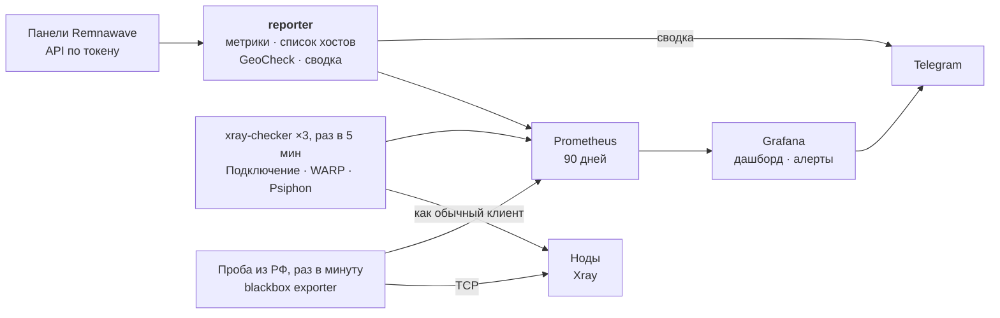

<p align="center">
  
</p>

<p align="center">
  <a href="https://github.com/3APA3A-3AHO3A/remnawave-monitoring/releases/latest"></a>
  <a href="https://github.com/3APA3A-3AHO3A/remnawave-monitoring/actions/workflows/tests.yml"></a>
  <a href="https://github.com/remnawave"></a>
  <a href="https://grafana.com"></a>
  <a href="https://prometheus.io"></a>
  
  <a href="LICENSE"></a>
</p>

<p align="center">
  <a href="#установка">🚀 Установка</a> &nbsp;·&nbsp; <a href="#алерты-в-telegram">🔔 Алерты</a> &nbsp;·&nbsp; <a href="#дашборд-grafana">📊 Дашборд</a> &nbsp;·&nbsp; <a href="#проба-из-рф">🇷🇺 Проба из РФ</a> &nbsp;·&nbsp; <a href="#настройки">⚙️ Настройки</a> &nbsp;·&nbsp; <a href="README.en.md">🇬🇧 English</a>
</p>

Мониторинг нод [Remnawave](https://docs.rw): графики в Grafana, алерты и ежедневная сводка в Telegram. Одна установка следит за одной или несколькими панелями. Ставится рядом с любой из панелей через `docker compose`.

> [!TIP]
> **Быстрый старт.** Сервер с Docker → `git clone` → заполнить `.env` и `config.toml` → `./apply.sh` → `rwmon check`. Подробно — в разделе [Установка](#установка). Первые результаты проверок появятся через 5–10 минут.

> [!IMPORTANT]
> **На ноды ничего не ставится.** Данные о панелях берутся из API по токену с правами только на чтение, а проверки подключаются к хостам как обычный клиент. Все сервисы мониторинга слушают только `127.0.0.1`.

## Как это выглядит

<p align="center">
  
</p>

## Возможности

- **Алерты в Telegram** — хост не принимает клиентов, не работает WARP / Psiphon, клиенты пропали с ноды, панель недоступна или тормозит, хост не открывается из РФ, сайт лёг, сертификат скоро истекает, нода перегружена. Когда всё починится, придёт сообщение о восстановлении. Подробнее — [Алерты](#алерты-в-telegram).
- **Дашборд Grafana** — главные цифры, таблица нод «всё в одной строке», карточка на каждую ноду, аутбаунды, здоровье панелей, GeoCheck. Переключатели «Панель» и «Нода».
- **Ежедневная сводка** — что изменилось в GeoCheck, сбои за сутки без дублей, пользователи, трафик и ближайшие оплаты серверов по каждой панели. Плюс HTML-таблица GeoCheck.
- **Несколько панелей** — у каждой свой чат и топик. Одинаковые хосты в разных панелях проверяются один раз.
- **Проба из РФ** — blackbox exporter на RU-ноде показывает блокировку IP, которую не видно из Европы.
- **Сайты и внешний сторож** — проверка сайта продаж и страницы подписки, срок сертификата, отметка в Healthchecks.io на случай, если упадёт сам мониторинг.

## Как устроено



Всё запускается одним `docker compose` и слушает только `127.0.0.1`: контейнер `config` собирает конфиги Prometheus, Grafana и проверок из `config.toml`, Grafana открывается наружу через nginx. Проба из РФ — по желанию, папка `probe/`.

- Все данные о панелях `reporter` берёт через API по токену. Поэтому для второй панели не нужен ни отдельный домен, ни доступ к её `/metrics`.
- Проверки хостов делает [xray-checker](https://github.com/kutovoys/xray-checker). Образ собирается локально из v1.3.1 с двумя небольшими патчами (см. [`checker/Dockerfile`](checker/Dockerfile)):
  - поддержка Hysteria2 с Salamander `packetSize`;
  - повторные попытки: одна случайная неудача (например, обрыв соединения WARP) не считается сбоем.

  Первая сборка занимает несколько минут.
- GeoCheck запускает сама панель на каждой ноде, как кнопка GeoCheck в карточке ноды.
- `reporter` написан на Python без внешних зависимостей.

**Трафик.**

- Одна проверка — это установка соединения и крошечный ответ. Три проверки раз в 5 минут дают около 100 МБ в месяц на хост.
- GeoCheck раз в сутки тратит несколько МБ на ноду; этот трафик расходует сама нода.

## Документация

<details>
<summary><b>🔔 Алерты в Telegram</b></summary>

### Алерты в Telegram

В сообщении есть список нод, а когда всё починилось, приходит сообщение о восстановлении. Пока что-то не работает, напоминание приходит раз в `repeat_minutes` (60 мин), про сертификат — раз в сутки.

| Алерт | Как определяется | Куда |
|---|---|---|
| Хост не принимает клиентов | проверка подключается к хосту как обычный клиент и не может открыть страницу. В сообщении после стрелки — нода, куда ведёт хост: «LTE 3 · OVRO → CDN 1». Упали все хосты одной ноды — проблема на ноде, упал один — на его пути | чат панели хоста |
| WARP / Psiphon не работает | через ноду не открывается адрес, который её роутинг отправляет в WARP или Psiphon | чат панели хоста |
| Клиенты пропали с ноды | нода подключена к панели, час назад на ней были люди, а теперь почти никого. Похоже на блокировку IP | все чаты |
| Аутбаунд не отвечает | клиенты шлют запросы в аутбаунд (например, `psiphon-out`), а ответов почти нет. **Выключено** (на паузе в Grafana): за выходами стоят балансировщики с резервом, а отправка файла выглядит так же, как поломка. Реальный отказ цепочки ловят проверки WARP / Psiphon | — |
| Панель недоступна по API | не отвечает панель, неверный адрес или токен | все чаты |
| Панель тормозит | процесс панели (api, scheduler или processor) 5 минут отвечает с задержкой больше `panel_lag_ms` (200 мс) | все чаты |
| Процесс панели перезапустился | время работы процесса сбросилось — обновление панели или падение | все чаты |
| Панель ест много памяти | процесс панели 15 минут занимает больше `panel_memory_mb` (1024 МБ) | все чаты |
| Хост не открывается из РФ | ни одна проба в России не может соединиться с хостом — похоже на блокировку IP | чат панели хоста |
| Сайт не открывается / из РФ | страница из `[[site]]` не отвечает с сервера мониторинга или с проб в России | все чаты |
| Сертификат скоро истекает | у сайта осталось меньше 14 дней | все чаты |
| Нода перегружена | 15 минут load выше 0,9 на ядро или занято больше 90% памяти | все чаты |
| Хосты не проверяются | хост есть в панели, но проверка его не видит (например, xray-checker не смог загрузить список) | все чаты |
| reporter / проверка хостов не работает | сломался сам мониторинг | все чаты |

Отключение ноды от панели здесь не отслеживается: Remnawave сама шлёт об этом вебхук.

</details>

<details>
<summary><b>📊 Дашборд Grafana</b></summary>

### Дашборд Grafana

Сверху переключатели «Панель» и «Нода»:

- главные цифры: клиенты, ноды, хосты со сбоем, скорость сети серверов, трафик, подписки;
- таблица нод — всё про ноду в одной строке: связь с панелью, онлайн и мини-график, проверки Подключение/WARP/Psiphon и «из РФ», сколько работают сервер и Xray, версия Xray, CPU, RAM, RX/TX, трафик и лимит;
- что не работает прямо сейчас, состояние панелей (API, версия, сколько работает без перезапуска, задержка) и сайтов;
- три общих графика: клиенты, сеть всех нод (приём вверх, отправка вниз), аутбаунды;
- «Каждая нода отдельно» — карточка на ноду: приём и отдача сервера;
- «Аутбаунды по нодам» (свёрнуто) — такие же карточки, но только трафик через выходы из фильтра «Аутбаунд» (WARP, Psiphon): видно, на какой ноде выход перестал отвечать;
- свёрнутые блоки:
  - «Сравнение нод» — все выбранные ноды на одном графике (клиенты, трафик, CPU, память, аутбаунды, задержка), чтобы видеть, какая выделяется;
  - «Здоровье панелей» — память, задержка и время работы процессов самой панели;
  - «Проверки хостов» — таблицы «хост × панель» и история сбоев;
  - «Проба из РФ»;
  - «GeoCheck» — какую страну видит каждый сервис, доступ к Netflix/ChatGPT и т.п., GeoIP-базы, тип и риск IP.

Дашборд собирается скриптом [`grafana/dashboard.py`](grafana/dashboard.py) — править удобнее там, потом `python3 grafana/dashboard.py`.

</details>

<details>
<summary><b>📰 Ежедневная сводка</b></summary>

### Ежедневная сводка

Ежедневная сводка в заданное время уходит во все чаты:

- что изменилось в GeoCheck (например, «Google видел ноду как FI, теперь RU»). «Требует внимания» — только новое со вчера, то, что не менялось, — одной строкой; RU-ноды и сервисы из `routed_services` не подсвечиваются;
- сбои за сутки: один сервер в двух панелях — одной строкой, сбои до `short_minutes` (2 мин) — одной строкой «и ещё N коротких», минуты, когда проба из РФ не достучалась сразу до трети хостов, считаются сбоем пробы, а не хостов;
- по каждой панели: пользователи, новые и истёкшие за сутки, пик клиентов и трафик по нодам, ближайшие оплаты серверов.

К сводке прикладывается HTML-файл с полной таблицей GeoCheck по всем нодам.

</details>

<details>
<summary><b>✅ Требования и подготовка панелей</b></summary>

### Требования

- Remnawave 3.3 или новее: нужен GeoCheck через API.
- Docker с плагином compose.
- Telegram-бот и чат (или группа с топиками), куда бот может писать. У каждой панели может быть свой чат.

### Подготовка в каждой панели

1. **API-токен.** Панель → Настройки → API-токены. Нужны только права на чтение:
   - Nodes: Get nodes;
   - Users: Get user by username;
   - Subscriptions: Get Raw Subscription by Short UUID, Get connection keys by user id;
   - Connections: Request Geocheck for Node, Get Geocheck for Node by Job ID;
   - System: Get Stats, Get Nodes Metrics, Get Stats Digest, Get Remnawave Information;
   - по желанию Infra Billing: Get infra billing nodes — тогда в сводке будут ближайшие оплаты.
2. **Служебный пользователь**, например `monitoring`:
   - без лимита трафика и без срока окончания;
   - в сквадах, где есть проверяемые хосты.
3. **Теги на хостах**, которые нужно проверять:
   - `MONITORING` — все три проверки: по одному прямому хосту на ноду;
   - `MONITORING_LITE` — только «Подключение», одна лёгкая проверка. Подходит для хостов с лимитом трафика (LTE, цепочки через CDN): 5–15 КБ за проверку, 50–130 МБ в месяц. Имя тега задаётся в `host_tag_lite`.

   Балансировщики и «автовыбор» не отмечайте.
4. **Роутинг нод.** Проверки идут через настоящий конфиг Xray на ноде:
   - «Подключение» открывает `https://www.google.com/generate_204`, этот адрес должен идти в `DIRECT`;
   - «WARP» открывает `https://icanhazip.com` — это домен из `geosite:category-ip-geo-detect`;
   - «Psiphon» открывает `http://ip-api.com/…`. В шаблон ноды нужно правило **выше** правила для WARP:
     ```json
     { "domain": ["domain:ip-api.com"], "outboundTag": "psiphon-out" }
     ```

   Адреса можно поменять в `config.toml`, раздел `[checks]`.

</details>

<details>
<summary><b>🚀 Установка</b></summary>

### Установка

#### Подготовка сервера мониторинга

Проверки держат на `127.0.0.1` по порту на каждый хост: 21000+, 22000+ и 23000+. Если система раздаёт эти же порты исходящим соединениям, проверка однажды не сможет запуститься («address already in use») и перестанет видеть новые хосты. Закрепите порты за проверками — больше это ни на что не влияет:

```bash
echo 'net.ipv4.ip_local_reserved_ports = 21000-21999,22000-22999,23000-23999' | sudo tee /etc/sysctl.d/90-rwmon.conf
sudo sysctl -p /etc/sysctl.d/90-rwmon.conf
```

`check` сам скажет, нужно ли это на вашем сервере.

#### Запуск

```bash
cd /opt/remnawave
git clone https://github.com/3APA3A-3AHO3A/remnawave-monitoring.git monitoring
cd monitoring
cp .env.example .env && chmod 600 .env                     # порты и вход в Grafana
cp config.example.toml config.toml && chmod 600 config.toml  # панели, Telegram, проверки
nano .env
nano config.toml

./apply.sh
docker compose exec reporter python -m rwmon check
```

`check` проверяет для каждой панели:

- API;
- служебного пользователя и хосты;
- бота;

и отдельно — метрики в Prometheus. Первые результаты проверок хостов появятся через 5–10 минут.

Пароли, в которых есть знак `$`, в `.env` берите в одинарные кавычки: `GRAFANA_ADMIN_PASSWORD='pa$$word'`.

</details>

<details>
<summary><b>⚙️ Настройки — config.toml и .env</b></summary>

### Настройки

**`config.toml`** — всё, что касается панелей. Каждое поле описано в [`config.example.toml`](config.example.toml).

Одна панель — один блок `[[panel]]`:

| Поле | Что это |
|---|---|
| `id`, `title` | короткий латинский id (метка на графиках) и подпись для людей |
| `api_url`, `api_token` | панель на этом же сервере — `http://127.0.0.1:3000`, другая — её домен |
| `monitor_user`, `host_tag`, `host_tag_lite` | чья подписка и какие хосты проверять |
| `host_suffix` | подпись к названиям хостов, чтобы хосты разных панелей не путались. У первой панели пусто, у остальных « · title» |
| `exclude_nodes` | ноды (имена или теги), за которыми не следить. Выключенные в панели ноды скрываются сами |
| `geocheck_exclude` | ноды, где не запускать GeoCheck |
| `host_exit` | куда ведёт хост, для алертов: `{ "LTE 3" = "CDN 1" }`. Нужно только для хостов через Cloudflare или промежуточный сервер — если адрес хоста совпадает с IP ноды, нода находится сама |
| `metrics_url` и логин | необязательно, точный трафик из `/metrics` панели (см. ниже) |
| `[panel.telegram]` | бот, чат и топик панели |

Общие разделы:

- `[schedule]` — время GeoCheck и сводки (UTC);
- `[checks]` — интервал, число попыток и адреса проверок;
- `[alerts]` — пороги алертов «клиенты пропали», «панель тормозит / ест много памяти», список аутбаундов и как часто напоминать (`repeat_minutes`);
- `[geocheck]` — какие страны подсвечивать и какие сервисы идут не с IP ноды (`routed_services`);
- `[report]` — что в сводке считать коротким сбоем и сколько минут API панели может молчать;
- `[healthcheck]` — внешний сторож.

После любого изменения выполните `./apply.sh`: он пересоберёт конфиги и перезапустит контейнеры. История графиков сохраняется.

**`.env`** — только Docker: порты, домен и первый вход в Grafana.

**Точный трафик.** В API панели трафик отдаётся уже округлённым («12.34 GiB»). Для графиков и сводки этого хватает. Алерту «аутбаунд не отвечает» (сейчас на паузе) нужны точные счётчики. Если панель на том же сервере, укажите её `/metrics`:

```toml
metrics_url = "http://127.0.0.1:3001/metrics"   # METRICS_PORT из .env панели
metrics_user = "…"                               # METRICS_USER
metrics_password = "…"                           # METRICS_PASS
```

Для панелей без `metrics_url` этот алерт просто не срабатывает.

**Одинаковые хосты в разных панелях** (ссылка совпадает всем, кроме названия — например, панели делят ноды через маппер UUID) проверяются один раз. Результат засчитывается каждой панели, где есть этот хост, и сбой приходит в чаты всех этих панелей. `rwmon links` показывает, какие хосты проверяются вместе.

**Точный трафик панели на другом сервере.** Откройте её `/metrics` через nginx на том же домене, что и панель, по секретному пути и с паролем:

```nginx
location /секретный-путь/metrics {
    proxy_pass http://127.0.0.1:3001/metrics;   # METRICS_PORT из .env панели
}
```

```toml
metrics_url = "https://panel.example.com/секретный-путь/metrics"
metrics_user = "…"        # METRICS_USER — пароль проверяет сама панель
metrics_password = "…"    # METRICS_PASS
```

**Куда уходят сообщения:**

- сбои хостов — в чат той панели, чей это хост;
- всё остальное (ноды, сводка, сбои мониторинга) — во все чаты.

Если у двух панелей один и тот же чат, сообщение придёт туда один раз.

</details>

<details>
<summary><b>🌐 Сайты и внешний сторож</b></summary>

### Сайты и внешний сторож

**Сайты** (`[[site]]` в `config.toml`) — раз в минуту reporter открывает страницу и смотрит код ответа, время ответа, ключевое слово (если задано) и срок сертификата. Так удобно следить за сайтом продаж, страницей подписки, доменом панели:

```toml
[[site]]
name = "Сайт"
url = "https://example.com"
keyword = "Купить"      # необязательно
```

Если корень сайта закрыт и отдаёт 404/502 (так обычно у страницы подписки), добавьте `any_status = true` — тогда любой HTTP-ответ означает «сервер жив». Точнее — указать ссылку подписки служебного пользователя: тогда проверяется, что подписка действительно отдаётся. Пробы из РФ для `any_status` используют модуль `http_any` — после обновления на RU-нодах выполните `git pull && docker compose restart`.

**Внешний сторож.** Если упадёт сам сервер мониторинга, он об этом не расскажет. Для этого — [Healthchecks.io](https://healthchecks.io) (бесплатно):

1. Проверка «мониторинг»: период 5 минут, запас 10 минут. Адрес — в `[healthcheck] ping_url`: reporter отмечается там сам.
2. Для сервиса на другом сервере (бот, сайт): ещё одна проверка и строка в cron того сервера, например
   `*/5 * * * * systemctl is-active --quiet mybot && curl -fsS -m 10 https://hc-ping.com/<uuid> >/dev/null`
   — отметка идёт, только пока процесс работает.

Уведомления Healthchecks.io умеет слать в Telegram.

</details>

<details>
<summary><b>🇷🇺 Проба из РФ</b></summary>

### Проба из РФ

Из России видно то, что не видно из Европы: например, блокировку IP ноды. На RU-ноду ставится [blackbox exporter](https://github.com/prometheus/blackbox_exporter), и Prometheus мониторинга раз в минуту просит его открыть каждый хост (TCP-соединение до IP:порта из подписки) и каждый сайт. Список адресов reporter обновляет сам.

На RU-ноде:

```bash
git clone https://github.com/3APA3A-3AHO3A/remnawave-monitoring.git /opt/rwmon-probe
cd /opt/rwmon-probe/probe
./install.sh <IP сервера мониторинга>
```

Скрипт создаёт самоподписанный сертификат и пароль, запускает контейнер, открывает порт 9115 в ufw только для IP мониторинга и печатает блок `[[probe]]` — его нужно вставить в `config.toml` мониторинга и выполнить `./apply.sh`.

Хосты на UDP (Hysteria2, TUIC, WireGuard) в пробы не попадают: TCP-соединение до их порта не открывается, даже когда всё работает.

Проб может быть несколько. Алерт «не открывается из РФ» срабатывает, только если хост не открывается ни с одной: так случайная проблема одной RU-ноды не даёт ложных тревог. Мобильные белые списки и поведение конкретных операторов так не проверить — проба стоит в датацентре.

</details>

<details>
<summary><b>🔐 Доступ к Grafana</b></summary>

### Доступ к Grafana

Grafana слушает только `127.0.0.1:3300`. Есть два способа её открыть.

**Через SSH-туннель**, без домена:

```powershell
ssh -L 3300:127.0.0.1:3300 user@сервер
# в браузере: http://localhost:3300
```

**Через nginx на поддомене.** Возьмите за основу пример [`nginx/grafana.conf.example`](nginx/grafana.conf.example).

- В примере уже есть ограничение частоты попыток входа.
- Сама Grafana тоже блокирует учётку после 5 неверных паролей.
- Регистрация и гостевой доступ отключены.

**Доступ только на просмотр.** Администрирование → Пользователи и доступ → Пользователи → «Новый пользователь», затем в карточке пользователя роль в организации — **Viewer**. Такой пользователь видит дашборды, но не меняет ни их, ни алерты, ни Telegram. Публичную ссылку («Поделиться внешне») не используйте: она открывает дашборд без пароля, а переключатели «Панель» и «Нода» в ней не работают.

**Совет.** Для поддомена используйте wildcard-сертификат или Cloudflare-прокси. Отдельный сертификат Let's Encrypt попадает в публичные журналы, и сканеры находят «секретный» поддомен за минуты.

`GRAFANA_ADMIN_USER` и `GRAFANA_ADMIN_PASSWORD` применяются только при первом запуске. Потом пароль меняется в самой Grafana: профиль → Change password.

</details>

<details>
<summary><b>💾 Место на диске</b></summary>

### Место на диске

- **История Prometheus** хранится 90 дней (`PROMETHEUS_RETENTION`) и не больше 2 ГБ (`PROMETHEUS_RETENTION_SIZE`) — что наступит раньше. Обычно это несколько сотен МБ.
- **Журналы контейнеров** — не больше 30 МБ на контейнер (3 файла по 10 МБ), старые удаляются сами.
- **GeoCheck** хранит историю за 60 дней и по одной картинке на ноду.
- **Сборка образов.** `./apply.sh` убирает старые версии образов, но кэш сборки Docker копится. Посмотреть: `docker system df`, почистить кэш старше недели: `docker builder prune -f --filter until=168h`.

</details>

<details>
<summary><b>🧰 Команды и обновление</b></summary>

### Команды

```bash
docker compose exec reporter python -m rwmon check              # проверить настройки
docker compose exec reporter python -m rwmon links              # какие хосты проверяются
docker compose exec reporter python -m rwmon report --dry-run   # показать сводку, не отправляя
docker compose exec reporter python -m rwmon report             # отправить сводку сейчас
docker compose exec reporter python -m rwmon geocheck --send    # GeoCheck + сводка сейчас

docker compose logs -f reporter                                 # журнал
git pull && ./apply.sh                                          # обновить
```

Что изменилось в новой версии — в [`CHANGELOG.md`](CHANGELOG.md) и на странице [релизов](https://github.com/3APA3A-3AHO3A/remnawave-monitoring/releases).

Если контейнер запустили позже времени сводки, сегодняшние GeoCheck и сводка выполнятся сразу после старта. Дальше — каждый день по расписанию.

</details>

<details>
<summary><b>↗️ Переход с версии для одной панели</b></summary>

### Переход с версии для одной панели

Раньше все настройки лежали в `.env`. Команда `migrate` переносит их в `config.toml`, в том числе доступ к `/metrics` панели:

```bash
cd /opt/remnawave/monitoring
cp .env .env.bak
git pull
docker compose build reporter
docker run --rm --env-file .env rwmon-reporter:local migrate > config.toml
chmod 600 config.toml
nano config.toml        # проверить; добавить вторую панель, если нужно
./apply.sh
```

После этого в `.env` нужны только строки из [`.env.example`](.env.example). Остальные можно убрать.

</details>

<details>
<summary><b>🧪 Для разработчиков</b></summary>

### Для разработчиков

- Тесты reporter: `cd reporter && python -m unittest discover -v tests` (Python 3.13, внешних зависимостей нет).
- Дашборд не редактируется руками: правьте [`grafana/dashboard.py`](grafana/dashboard.py) и пересоберите JSON — `python3 grafana/dashboard.py`. CI проверяет, что `grafana/dashboards/` совпадает с результатом скрипта.
- CI ([`tests.yml`](.github/workflows/tests.yml)) на каждый push и PR: тесты reporter, сборка дашборда, проверка `docker-compose.yml` и сборка образа xray-checker с патчами.
- [Dependabot](.github/dependabot.yml) раз в неделю открывает PR на новые версии образов (Prometheus, Grafana, blackbox exporter, базовые образы) и GitHub Actions.
- [`xray-checker-release.yml`](.github/workflows/xray-checker-release.yml) раз в неделю смотрит релизы xray-checker: если патчи ложатся на новую версию — открывает PR, если нет — issue.
- Релиз: добавить раздел в [`CHANGELOG.md`](CHANGELOG.md), затем `git tag vX.Y.Z` и `git push origin vX.Y.Z` — [`release.yml`](.github/workflows/release.yml) создаст релиз с текстом из CHANGELOG.

</details>

## Лицензия

MIT — см. [LICENSE](LICENSE).
